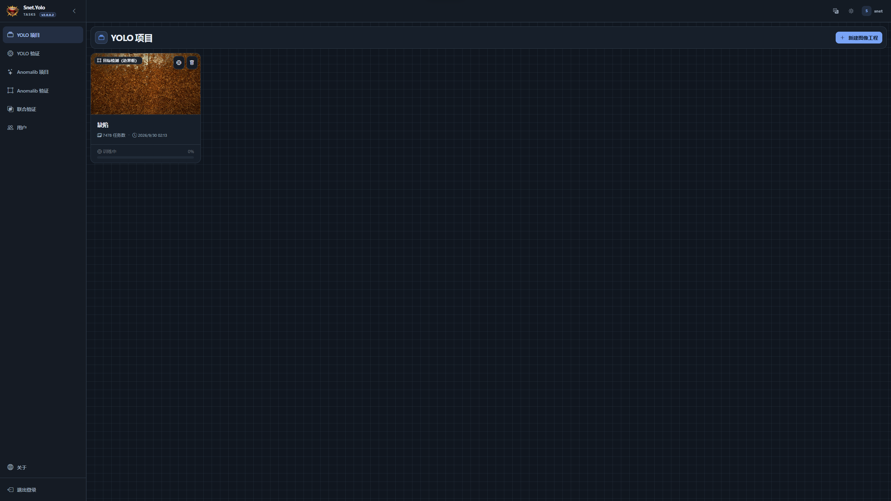
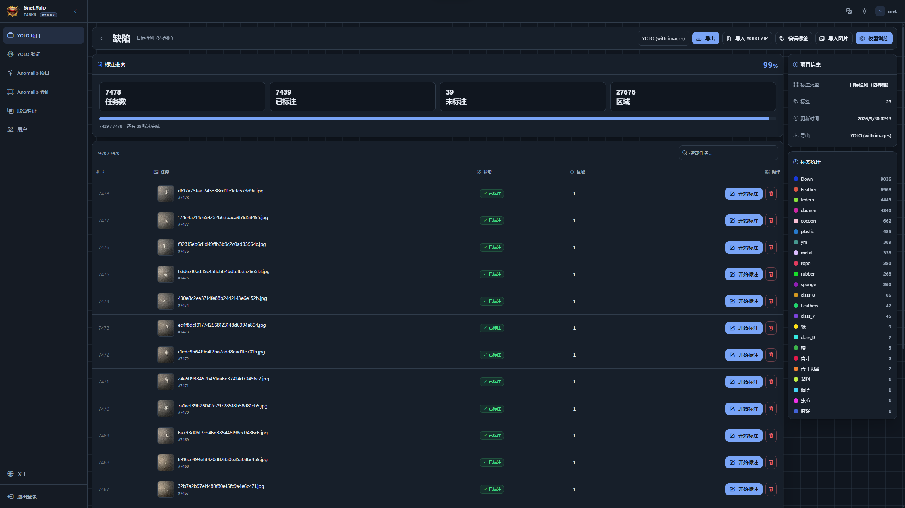
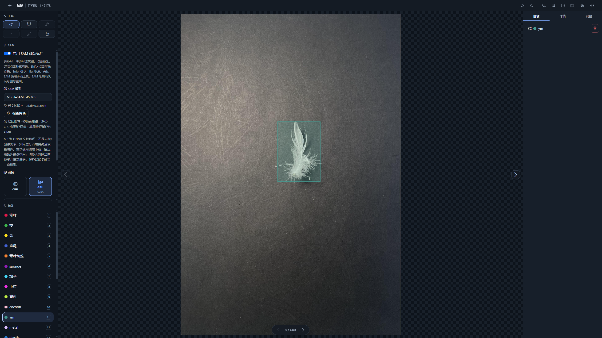
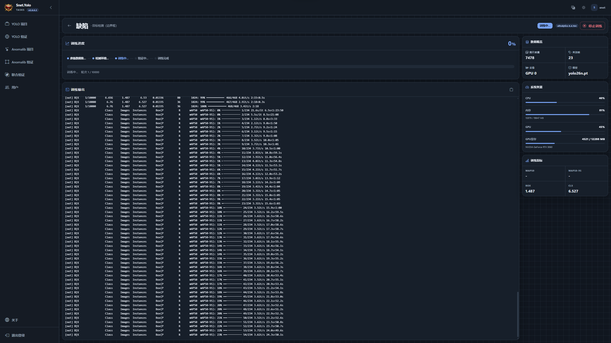
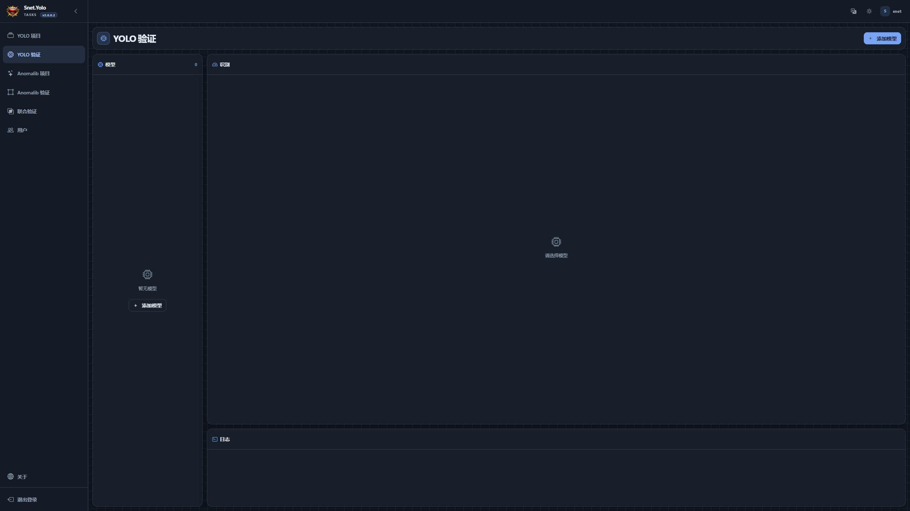
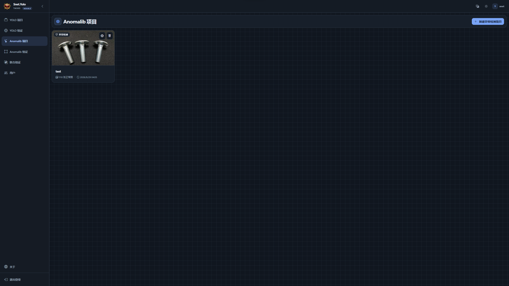
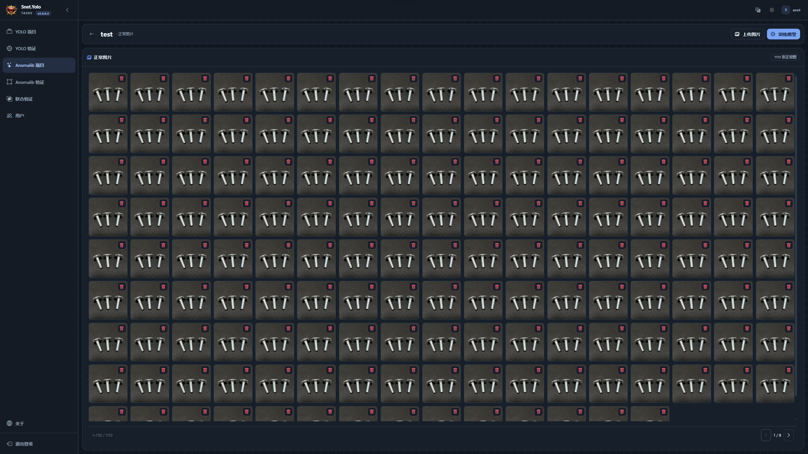
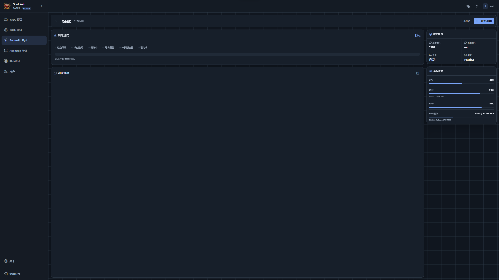
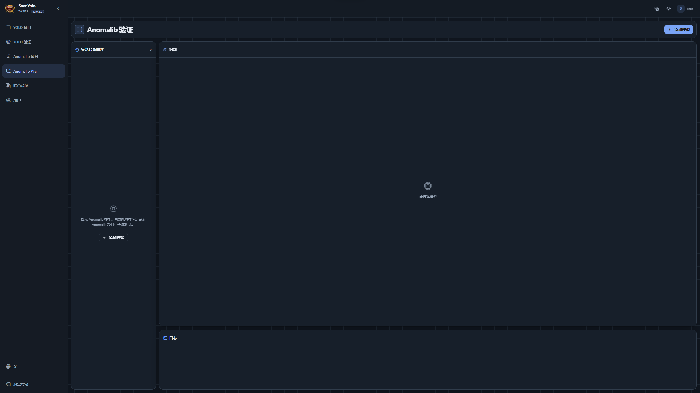
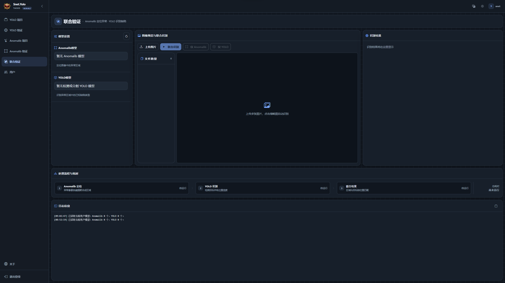

<h1 align="center">🔍 Snet.VisualIdentity</h1>

<p align="center">
  <br/>
</p>

<p align="center">
  <b>A .NET 10 industrial vision platform for YOLO and Anomalib</b>
</p>

<p align="center">
  
  
  
</p>

<p align="center">
  🚀 Efficient · 🧩 Flexible · 📦 Easy to deploy · 🔒 Secure
</p>

<p align="center">
  <a href="https://snet.cn"><b>🌐 Website</b></a> ·
  <a href="https://github.com/shunnet/VisualIdentity"><b>📦 GitHub</b></a> ·
  <a href="https://snet.cn/EaiUj"><b>🎬 Demo</b></a>
</p>

<p align="center">
  English | 📖 <a href="README.md"><b>简体中文</b></a>
</p>

## 📑 Table of Contents

| | | |
|---|---|---|
| [🌟 Introduction](#-introduction) | [🎯 Use Cases](#-use-cases) | [🏗️ Architecture](#-architecture) |
| [⚡ Quick Start](#-quick-start) | [🏷️ Tasks Workspace](#-tasks-web-annotation-and-training-workspace) | [🎬 Video & FFmpeg](#-ffmpeg-deployment-for-video-validation) |
| [🖥️ Interface Display](#-interface-display) | [📦 Source Project References](#-source-project-references) | [🔌 API Reference](#-api-reference) |
| [⚙️ Configuration](#-configuration) | [🧠 Supported Tasks](#-supported-tasks) | [🖥️ Execution Providers](#-execution-providers) |
| [🐳 Docker Deployment](#-docker-deployment) | [🧪 Tests](#-testing) | [🔒 Security](#-security-features) |
| [🪄 SAM Assistance](#-sam-assisted-point-annotation) | [🧩 Joint Verification Demo](#-joint-verification-console-demo) | [📚 Dependencies](#-dependencies) |

## 🌟 Introduction

**VisualIdentity** is a **.NET 10** vision platform for project management, image annotation, model training, ONNX validation, and API access. **YOLO** covers five tasks—object detection, classification, instance segmentation, pose estimation, and oriented detection—using labeled data to recognize objects and known defects. **Anomalib** trains on normal images to locate regions that differ from expected appearance without labeling every defect type. The two model families are managed separately, share inference capabilities in `Snet.Yolo.Server`, and support CPU/CUDA execution. Tasks selects hardware in Settings. The API also uses one deployment package, defaults to GPU 0, and exposes a public endpoint to select CPU or a specific GPU. **SAM** assists rectangle, polygon, and brush annotation through object point prompts, with MobileSAM, SAM 2.1 Tiny, SAM ViT-B/L/H, and SAM 3 Tracker image point segmentation; results are saved after manual confirmation.

For industrial inspection, Anomalib can answer “where is the anomaly?” and a YOLO model trained on the relevant defect classes can answer “what kind of defect is it?” Tasks provides a **Joint Validation** page that selects the signed-in user's existing models, runs both on the same image, and associates known detections with anomaly regions. Either model can also run alone for comparison.

Validation calls `Snet.Yolo.Server` in-process, without an HTTP API hop: YOLO model upload and per-user lookup reuse `ManageOperate`, while Server runs YOLO inference; `AnomalibModelRegistry` handles Anomalib packages and Server runs their ONNX inference. Joint Validation also queries both model families, runs inference, and matches results inside Server. Tasks owns the UI, upload progress, signed-in user identity, and video orchestration.

> 💡 The solution now targets **.NET 10** throughout; the WPF tool targets `net10.0-windows`.

### ✨ Core Features (Overview)

#### 🧠 Recognition & Models

| Feature | Description |
|---------|-------------|
| 🎯 **Five YOLO Tasks** | Object detection · OBB · classification · instance segmentation · pose estimation, managed uniformly and switchable on demand |
| 🔎 **Anomalib Localization** | Train PaDiM, EfficientAD Small, or PatchCore on normal images; validation returns anomaly scores, regions, and heatmaps |
| 🧠 **Separate Model Management** | YOLO models use SQLite; Anomalib models are registered per user and support ONNX package import, download, and deletion |
| 🖱️ **Image validation** | YOLO and Anomalib have separate validation pages; Joint Validation offers combined recognition, Anomalib-only, and YOLO-only modes |
| 🔍 **Image viewer** | Open a thumbnail to inspect the original image, zoom, pan, and browse images; the YOLO result viewer can also toggle the original |
| 🎬 **Video validation** | YOLO aggregates detections by label; Anomalib counts anomalous frames and exports a video annotated with regions |
| ⚡ **Hardware Execution** | YOLO supports CPU and NVIDIA CUDA / TensorRT; Anomalib ONNX inference supports CPU / CUDA; Tasks and API share Server core logic |
| 📊 **Inference statistics** | Inference timings, target confidence, anomaly regions, and video progress; throughput depends on the model and hardware |

#### 🏷️ Tasks Web Workspace

| Feature | Description |
|---------|-------------|
| 🏷️ **Dual-model workspace** | Manage, annotate, train, and validate YOLO projects; upload normal images, train, and validate Anomalib projects |
| 📤 **Upload progress** | The upload center retains jobs within one browser connection; navigation preserves progress/cancellation, but refresh does not guarantee resumption |
| 🗂️ **Refresh recovery** | YOLO keeps queues per user/model; Anomalib and Joint Validation retain files, selections, parameters, and results per user, within the current application process |
| 🎞️ **Image & video validation** | Up to 100 files per batch; videos are processed frame by frame in the background with live progress and ETA |
| 📥 **Incremental import** | YOLO ZIPs can be uploaded batch by batch: same-named classes are reused, new ones appended, and annotation indices remapped to project labels |
| 🪄 **SAM annotation** | Foreground points, Shift-click background points, Enter to confirm, Esc to cancel; model, enabled state, and device preferences are restored |
| 🔗 **Label selection sync** | Selecting an annotation in the right-hand region list or on the canvas also selects its label in the left label bar, so further drawing keeps using that label |
| 🐍 **Model export** | Tasks exports trained YOLO ONNX models; the standalone Python script accepts weights, format, opset, and device |
| 🧩 **Joint Validation Demo** | A standalone console calls Core → Server and saves annotated images, heatmaps, and structured results for integration |
| 🖥️ **WPF Debug Tool** | Visual verification for five YOLO tasks, data preparation and runtime CPU/selected-GPU switching; SAM, Anomalib, and Joint Validation pages belong to Tasks |

#### 🏋️ Training

| Feature | Description |
|---------|-------------|
| 🔢 **500 epochs by default** | YOLO and EfficientAD use a 100–10,000 epoch-limit slider in steps of 100 and can stop early; PaDiM and PatchCore have no epoch control |
| 🎯 **No validation split by default** | YOLO uses all training data by default; enable "use validation set (auto 10%)" in the training dialog when you need objective metrics |
| 🩺 **Dataset health check** | Logs per-class instance counts, image counts, target sizes, and validation size; warns about missing classes, small targets, and insufficient data |
| 🔬 **Post-training check** | Reads `results.csv` metrics and checks the training set at confidence 0.25 when metrics are suspect or validation samples are insufficient; diagnostic results do not replace evaluation on an independent test set |
| 📥 **One-line weight download** | When a proxy intercepts GitHub (curl 60), the log prints a system-specific `curl` command with the proxy/CA flags already filled in, and the target is reused automatically |
| 🔎 **Anomalib training calibration** | Check ONNX parity and normal-image false positives per image; automatically register passing models and retain failed models with detailed reports for optional manual import |
| 📈 **Training metrics page** | Every run is archived (successful, failed, cancelled and calibration-failed alike); the **Training metrics** entry on each project card shows summary, best model, per-run details and curves, with per-run export (YOLO `.pt` / ONNX, Anomalib ONNX package / ONNX / calibration report) and delete |
| 📊 **Live training metrics** | The right side of the training pages shows live metrics with a line chart: the mAP50-95 curve for YOLO; for Anomalib stage progress, EfficientAD epoch / loss / validation AUROC curve, and PatchCore VRAM planning and threshold calibration |
| 🩺 **Environment check & reset** | **Settings → Environment management** checks the GPU dependencies of SAM, YOLO and Anomalib (including a real tensor operation on the GPU) and can reset them: remove the old environment, install the latest compatible dependencies and verify |
| 🎮 **GPU setting sync** | When Settings selects an NVIDIA GPU, SAM and the YOLO / Anomalib training dialogs default to that GPU; with CPU selected the training dialogs default to Auto |

#### 🚀 Deployment & Operations

| Feature | Description |
|---------|-------------|
| 🌍 **Multi-platform Releases** | WPF on Windows; Tasks/API packages for Windows and Linux; Linux Docker images |
| 🛠️ **FFmpeg self-check** | Runs on video upload: Windows shows a dialog (manual path / silent download+install), Linux installs globally through apt, and failures never block image flows |
| 🔤 **CJK Text Rendering** | Video labels use a CJK font; Linux installation is attempted, while offline/unprivileged hosts require a supplied font |
| 📦 **Ready to use** | Tasks selects CPU/CUDA in Settings; API selects it through a public endpoint. Server includes provider implementations; each host restores exactly one native ONNX Runtime package |

#### 🔒 Security & Performance

| Feature | Description |
|---------|-------------|
| 🔒 **Explicit Security Boundary** | Tasks uses cookie login and CSRF protection; the API is intentionally anonymous with rate limiting, CORS, and security headers |
| 🔐 **Per-user Tasks isolation** | Projects, annotations, models, validation data, and files are isolated per signed-in user while sharing the training environment; API models use a separate service account |
| 🔄 **Session lifetime** | The YOLO API caches sessions; Anomalib caches within its inference service; SAM retains at most one session pair; Tasks YOLO image validation creates and disposes a session per request |
| 🧵 **Async task handling** | Uploads, training orchestration, and file I/O run asynchronously; long video recognition shows progress and supports cancellation |

> 📖 Details live in the sections below: [Tasks workspace](#-tasks-web-annotation-and-training-workspace) · [Video & FFmpeg](#-ffmpeg-deployment-for-video-validation) · [Configuration](#-configuration) · [Security](#-security-features) · [Performance](#-performance)

## 🎯 Use Cases

💡 These are application directions enabled by the models, not built-in business systems. Tracking, alerts, clinical decisions, and similar workflows require appropriate models, rules, and field validation.

| Scenario | Purpose | Recommended Models |
|----------|---------|--------------------|
| 🏭 **Industrial QC** | Locate suspicious regions, then identify known defect classes; also detect foreign objects and count parts | Anomalib, Detection, Segmentation |
| 🛒 **Retail Analytics** | Customer behavior tracking, shelf product detection | Detection, Classification |
| 🛡️ **Smart Security** | Anomaly monitoring, fall detection, zone intrusion | Pose, Detection |
| 🚗 **Autonomous Driving** | Road target detection, traffic sign recognition | OBB, Detection |
| 🏥 **Medical Imaging** | Lesion segmentation, cell classification | Segmentation, Classification |
| 📄 **Document Analysis** | Rotated text detection, table recognition | OBB |
| 🌐 **Edge Computing** | Windows/Linux x64 CPU and Linux ARM64 CPU; CUDA releases target x64 NVIDIA environments | CPU, CUDA |

## 🏗️ Architecture

🧠 YOLO parsing, preprocessing, version-specific task modules, drawing, tracking and video code now live in `Snet.Yolo.Server/yolo` under `Snet.Yolo.Server.yolo.*`. The separate `YoloDotNet` project and assembly have been removed. API, Tasks, WPF and Demo all reuse Server. Update using directives and reflection type names in integrations, and deploy into a clean directory; models, labels, preprocessing and postprocessing rules remain unchanged. Upstream copyright markers and acknowledgements are retained.


```
VisualIdentity/
├── Snet.Yolo.Server/              # 🗄️ SQLite, YOLO / anomalib / sam inference and joint matching
├── Snet.Yolo.Api.Shared/          # 🔗 Shared API layer (Shared Project: controllers / security / imaging)
├── Snet.Yolo.Api/                 # ⚙️ Unified API; GPU by default, endpoint selects hardware (HTTP 5157 · HTTPS 7257)
├── Snet.Yolo.Tasks.Core/          # 🏷️ Annotation configuration, editing, export and training domain logic
├── Snet.Yolo.Tasks.Shared/        # 🔗 Shared Tasks project (Blazor components, services and static assets)
├── Snet.Yolo.Tasks/               # ⚙️ Unified Tasks; hardware selected in Settings (HTTP 5151 · HTTPS 7351)
├── Snet.Yolo.Tool/                # 🛠️ WPF desktop debug tool
├── Snet.Yolo.Test/                # 🧪 xUnit regression and integration tests
├── Snet.VisualIdentity.JointVerificationDemo/ # 🧩 Standalone joint validation console and solution
├── Snet.Py/                       # 🐍 Python model export scripts
├── .github/workflows/release.yml   # 🚀 Build, tests, packages, and GHCR releases
├── docker/                        # 🐳 Unified Tasks and API images
├── VisualIdentity.sln             # 🧩 Solution entry point
└── appsettings.json               # ⚙️ Shared API configuration
```

📌 Ports above come from development `launchSettings.json`. Set listening addresses explicitly for published deployments; development ports are not fixed production defaults.

### 🔄 Data Flow

```
Tasks (signed-in user)
├─ YOLO validation → ManageOperate → YoloValidationService → IdentityOperate → Server.yolo
├─ Anomalib validation → AnomalibModelRegistry → AnomalibOnnxInference
├─ Joint Validation → JointValidationService → Anomalib → YOLO (if anomalous) → JointValidationMatcher
└─ SAM annotation → SamModelStore / SamOnnxRuntime → mask → save after confirmation

HTTP API (separate host, anonymous endpoints)
├─ YOLO → rate limiting / validation → ManageOperate → cached inference session → JSON
│                                              └─ IdentityDrawAsync → images and details on disk
└─ Anomalib → rate limiting / validation → AnomalibModelRegistry → ONNX → JSON / optional heatmap
```

## ⚡ Quick Start

### 🧰 Prerequisites

- 📦 [.NET 10 SDK](https://dotnet.microsoft.com/download/dotnet/10.0)
- 🧠 Direct validation/API inference needs a business model: YOLO ONNX, or Anomalib ONNX plus its manifest; alternatively train through Tasks first.
- 🐍 Training needs Python 3, pip, and venv; SAM annotation and ONNX validation do not use the Python training environments.
- 🎮 CUDA inference requires compatible NVIDIA drivers and CUDA/cuDNN; video validation additionally needs FFmpeg/FFprobe.
- 🗄️ The runtime account needs write access to data, models, training, SAM, and tool directories.

### 1️⃣ Clone

```bash
git clone https://github.com/shunnet/VisualIdentity.git
cd VisualIdentity
```

### 🏷️ Use the Tasks Web Workspace

```bash
# CPU variant
dotnet run --project Snet.Yolo.Tasks
```

Open `http://localhost:5151`. The first startup creates the default administrator `snet` with password `123456`. Set `SNET_BOOTSTRAP_ADMIN_PASSWORD` before starting to override it; the same variable can synchronize an existing administrator during account recovery.

🎨 **Settings** at the bottom of the sidebar provides brand title, description, LOGO preview/upload, language, and light/dark themes. Administrators save the shared brand for the sidebar, login page, and browser titles; regular users can change only their browser preferences. Images support PNG, JPEG, and WebP, up to 1 MiB before and after conversion and 2048 × 2048 pixels, with a restore-default option. Site settings persist in `wwwroot/data/settings/appearance.json`; keep the existing `wwwroot` Docker volume across deployments. Saving as an administrator also sets the defaults for new browsers. Existing browser preferences take priority and survive refresh and login.

🛡️ Deleting projects, images, annotations, models, or users and stopping YOLO / Anomalib training require confirmation. Stop dialogs explain interruption and potential loss of unsaved progress. Cancel receives focus by default, and repeated submission is disabled while the action runs.

> 🔐 Set a non-default administrator password before deployment and serve through HTTPS or a trusted reverse proxy.
> 🐍 Tasks creates separate shared environments for YOLO and Anomalib; training devices are selected by Python/PyTorch, independently of the ONNX Runtime setting.

⚙️ Start the single `Snet.Yolo.Tasks` project. Administrators select **CPU / NVIDIA GPU** and one GPU in **Settings → ONNX Runtime inference hardware**, then click **Apply inference hardware**.

| Project | Runtime hardware | Supported release targets |
|---|---|---|
| `Snet.Yolo.Tasks` | CPU / CUDA selected in Settings | Windows/Linux x64; Linux ARM64 supports CPU only |

- 🔒 This is a server-wide setting. Ordinary users can view it but cannot change it. It is atomically stored in `wwwroot/data/settings/onnx-runtime.json` and survives host/container restarts when the data directory is persisted.
- 🔄 New sessions use the saved device; active sessions finish safely. Anomalib retires device-specific caches after their final active lease. Failed CUDA preparation retains the previous setting, and inference does not silently switch to CPU.
- 🪄 SAM retains its own annotation-page CPU/GPU selection. Python training also retains its existing independent device choices.
- 📦 The x64 Tasks package uses one GPU native runtime with both CPU and CUDA execution paths. ARM64 uses the CPU native package. Server holds the provider implementations and only the Managed dependency; each final host selects exactly one native package.
- 🚚 When upgrading old deployments, deploy the new application into a clean directory and preserve/mount `wwwroot/data`, `wwwroot/db`, `train`, `sam` and configured model directories. The renamed executable is `Snet.Yolo.Tasks.dll`; renaming the project does not automatically move deployed data. Do not merge old CPU/GPU native DLLs into the new publish directory.

### 2️⃣ Run the unified API

```bash
cd Snet.Yolo.Api
dotnet run
```

🌐 Open `http://localhost:5157/swagger` for Swagger UI (Development environment only).


🎮 A fresh API deployment defaults to **CUDA GPU 0**. Without a GPU or CUDA libraries, the host still starts and serves health/hardware endpoints; select CPU before inference. There is no silent fallback. API settings are independent of Tasks, SAM and Python training.

```bash
# Query the configured device
curl http://localhost:5157/api/runtime/hardware
# Select CPU
curl -X PUT http://localhost:5157/api/runtime/hardware \
  -H "Content-Type: application/json" -d '{"Hardware":"Cpu","GpuId":0}'
# Select GPU 1; validate that device and its native environment before saving
curl -X PUT http://localhost:5157/api/runtime/hardware \
  -H "Content-Type: application/json" -d '{"Hardware":"Cuda","GpuId":1}'
```

💾 Settings persist in the API's `wwwroot/settings/onnx-runtime.json`, survive restart, and take precedence over deployment defaults `OnnxRuntime:Hardware/GpuId`. For a fresh deployment, `OnnxRuntime__Hardware=Cpu` explicitly selects CPU. Linux ARM64 packages require CPU; their Docker image already sets this override. Failed CUDA preparation or writes preserve the previous configuration and caches. New requests use the new device; active requests finish safely, and delayed old requests cannot refill retired caches.

🚚 Upgrade old CPU/CUDA API deployments into a clean directory and start `Snet.Yolo.Api.dll`. Preserve all of `wwwroot`; move old root-level `anomalib-api`, `tensorrt-cache` and `tensorrt-calibration` into their matching `wwwroot` subdirectories. The old `gpuid` form field no longer selects a device; use the global endpoint above. Do not mix old CPU/GPU native DLLs into the new directory.

### 3️⃣ Upload a Model & Infer

```bash
# 1. Upload ONNX model
curl -X POST http://localhost:5157/api/yolo/Add \
  -F "file=@your_model.onnx" \
  -F "describe=my detection model" \
  -F "onnxType=ObjectDetection"

# 2. Fast inference (coordinates / labels / confidence only)
curl -X POST http://localhost:5157/api/yolo/Identity \
  -F "onnxIndex=1" -F "file=@test.jpg" \
  -F 'paramJson={"Confidence":0.2,"Iou":0.7}'

# 3. Full inference (annotated image + coordinates + image URL)
curl -X POST http://localhost:5157/api/yolo/IdentityDraw \
  -F "onnxIndex=1" -F "file=@test.jpg" \
  -F 'paramJson={"Confidence":0.2,"Iou":0.7}'
```

## 🏷️ Tasks Web Annotation and Training Workspace

🧩 `Snet.Yolo.Tasks.Shared` contains the Blazor workspace implementation imported by the single `Snet.Yolo.Tasks` host. Hardware is selected in Settings. The workspace covers the workflow from dataset preparation through model validation:

1. 🔐 Sign in, create a project, and choose a detection, segmentation, classification, pose, or OBB template.
2. 🖼️ Import images and annotate rectangles, oriented boxes, polygons, keypoints, or classes in the browser.
3. 📦 Export YOLO labels or a YOLO ZIP dataset containing the source images.
4. ⚙️ Configure epochs, image size, base model and device while viewing live training phases, metrics and logs.
5. 🚀 Download the resulting `best.pt`, or export ONNX and open it directly in the validation page.

### ✏️ Image polygon and curve annotation

Close a manual polygon by clicking its first vertex, double-clicking, or pressing Enter. With the selection tool, select a polygon to reveal vertex/curve controls. Drag square handles to move vertices and round handles to edit curve controls. At least three vertices remain; removing one joins its neighbors with a straight edge. Esc cancels a drag; Ctrl+Z / Ctrl+Shift+Z undo/redo edits.

Annotation JSON retains percentage-based control points in `value.snet_bezier` for editable reloads. YOLO segmentation and COCO exports flatten curves into polygons with at most 0.5px error in original-image coordinates, without changing the editable annotation. Third-party JSON tools unaware of this extension only read the anchors. This feature is image-only and does not include video tracking.

### 🪄 SAM-assisted point annotation

The model, assistance toggle and selected device are saved per signed-in user in the current browser and restored after refresh; unavailable GPUs revert to CPU. Prompt points and unconfirmed previews are not persisted. Preferences cannot survive refresh when browser local storage is disabled.

**Compute device**: All six SAM models support CPU or one selected NVIDIA GPU. The UI detects GPU indices, names and VRAM and reuses training-style device buttons and hardware cards for manual selection; CPU is the default. ARM64 Tasks exposes CPU only; x64 Tasks supports GPU independently of the global validation setting, with compatible drivers and CUDA/cuDNN required. GPU initialization failures are reported, not silently downgraded to CPU; unsupported ONNX operators may still run on CPU. This interactive single-image pipeline does not support joint multi-GPU inference, so there is no multi-selection. Switching devices clears previews and image features; the next click creates sessions on the selected device. Only one session pair remains resident; different users switching models or devices incur reload overhead.

Enable **SAM assistance** below the tools, choose rectangle, polygon or brush, and click an object to preview it. Additional clicks include foreground; Shift+click excludes background. Click **Confirm annotation** to save. Rectangles use object bounds, polygons use a simplified outer contour, and brushes use a filled mask. Disable SAM for manual tools. SAM does not classify objects or guarantee accurate one-click boundaries; review its output.

Choose **MobileSAM (default), SAM 2.1 Tiny, SAM ViT-B, SAM ViT-L, SAM ViT-H, or SAM 3 (points)** below the tools, with file-size and resource hints shown alongside. `Snet.Yolo.Server` runs ONNX directly, without the API or a Python environment. SAM device selection is independent of the global validation setting; supported x64 Tasks packages expose both CPU and CUDA. Encoding is reused per image and model; switching either clears unconfirmed previews, releases page features, and cancels pending requests. The first download checks upstream for the latest weights in the application's verified compatibility catalog, pins the actual repository commit, and verifies SHA-256 for archives, ONNX and external weights. Toggle again to retry after failure. Only one model session pair is resident; old sessions are released before loading another model to avoid holding multiple models in RAM/VRAM. Different choices across users add model reload overhead.

**Versions and updates**: When SAM is enabled, the installed commit and **Check for updates** are shown. **Update model** appears when compatible new weights are available; **Restore previous version** becomes available after a successful update. Existing installations are never automatically replaced. A newer commit containing identical verified weights may be pinned; changed, unverified upstream weights are reported but not used. Maintainers must validate the ONNX contract and quality, retain historical catalog entries, and ship an updated compatibility catalog with the application. “Latest compatible” does not mean arbitrary upstream latest or guaranteed better quality. Currently each model has one verified weight version, so no update button appears without new compatible weights. If the upstream check fails, first downloads fall back to the application's pinned recommendation; installed versions remain unchanged.

Each model's `active-model.json` records the active and previous versions. Manual updates download into `.versions/<actual commit SHA>/` and atomically switch the record only after integrity verification and an encoder/decoder smoke run on the selected CPU/GPU. Download, validation or cancellation failures preserve the previous version; inactive downloaded files remain as retry cache. Old files are retained for rollback and already-encoded images in other pages. Updates are server-wide and affect all users: the initiating page clears unconfirmed previews and features, other pages' cached features retain their original decoder, and newly encoded images use the active version. Previous and candidate versions require additional disk space. Offline deployments can still provide verified files or ZIPs in the directories below.

| Model | Total ONNX file size | Per-image features | Resource guidance |
| --- | --- | --- | --- |
| MobileSAM | About 45 MB | About 4 MB | Low resource use; recommended default for CPU/low-VRAM devices |
| SAM 2.1 Tiny | About 126 MB | About 16 MB | Moderate use; GPU recommended, slower initial CPU processing |
| SAM ViT-B | About 376 MB | About 4 MB | Large weights and intermediate computations; prefer GPU, slower initial CPU encoding |
| SAM ViT-L | About 1251 MB | About 4 MB | Higher RAM/VRAM use; GPU recommended, slow initial CPU encoding |
| SAM ViT-H | About 2567 MB | About 4 MB | Highest resource use; prefer a sufficiently provisioned GPU; low VRAM may cause out-of-memory failures |
| SAM 3 (points) | About 1894 MB | About 21 MB | Tracker image point segmentation; high RAM/VRAM use, slower initial CPU encoding; prefer a sufficiently provisioned GPU |

**File size and feature cache are not total RAM/VRAM requirements**. Weights, intermediate computations and source images add memory; actual use depends on hardware, backend and image dimensions. Download/extraction needs additional disk space (Tiny archive about 117 MB; ViT-B about 349 MB; ViT-L about 1162 MB; ViT-H about 2384 MB). The ViT-H external weights must remain alongside its encoder. Larger does not guarantee better results on every image; compare on your own data. All users share models under the **application root**, outside training or project directories:

```text
application root/
└── sam/
    ├── mobile_sam_image_encoder.onnx
    ├── sam_mask_decoder_multi.onnx
    ├── sam2.1-tiny/
    │   ├── sam2.1_hiera_tiny.encoder.onnx
    │   └── sam2.1_hiera_tiny.decoder.onnx
    ├── sam-vit-b/
    │   ├── sam_vit_b_01ec64.encoder.onnx
    │   └── sam_vit_b_01ec64.decoder.onnx
    ├── sam-vit-l/
    │   ├── sam_vit_l_0b3195.encoder.onnx
    │   └── sam_vit_l_0b3195.decoder.onnx
    ├── sam-vit-h/
    │   ├── sam_vit_h_4b8939.encoder.onnx
    │   ├── sam_vit_h_4b8939.encoder_data.bin
    │   └── sam_vit_h_4b8939.decoder.onnx
    └── sam3/onnx/
        ├── vision_encoder.onnx
        ├── vision_encoder.onnx_data
        ├── prompt_encoder_mask_decoder.onnx
        └── prompt_encoder_mask_decoder.onnx_data
```

For offline deployment, copy both same-named files from the [pinned Acly/MobileSAM revision](https://huggingface.co/Acly/MobileSAM/tree/0d3b403339b4674a82493d5e97964dd78089ddc8) into `sam` (write permission is required). Files are still verified; mismatched files are preserved with an error. Configure trusted proxy certificates; TLS validation is not disabled. Weights originate from [MobileSAM](https://github.com/ChaoningZhang/MobileSAM), with ONNX conversion provided by Acly; comply with upstream licenses when redistributing models.

Additional models use the [pinned SAM 2.1 Tiny archive](https://huggingface.co/vietanhdev/segment-anything-2.1-onnx-models/blob/6a3ac868340a3196a349050a6efae22a5acc0330/sam2.1_hiera_tiny_20260221.zip) and [pinned SAM ViT-B archive](https://huggingface.co/vietanhdev/segment-anything-onnx-models/blob/9effc01a9e135621d710d49159f1ffb0b6f724dc/sam_vit_b_01ec64.zip), exported by vietanhdev from Meta SAM/SAM 2.1. For offline use, place the ZIP in its model subdirectory for verified extraction, or place the required extracted files as shown above. Only fixed ONNX and external-weight entry names are extracted; archive configuration/code is never executed. User-supplied ZIPs are preserved; archives downloaded in the current preparation are removed after successful extraction. ViT-L and ViT-H use [sam_vit_l_0b3195.zip](https://huggingface.co/vietanhdev/segment-anything-onnx-models/blob/9effc01a9e135621d710d49159f1ffb0b6f724dc/sam_vit_l_0b3195.zip) and [sam_vit_h_4b8939.zip](https://huggingface.co/vietanhdev/segment-anything-onnx-models/blob/9effc01a9e135621d710d49159f1ffb0b6f724dc/sam_vit_h_4b8939.zip) from the same pinned repository revision. All three ViT-H files must be present and pass verification. Large downloads have a cancellable 30-minute timeout.

🧠 **SAM 3 scope**: Uses the [pinned onnx-community Tracker ONNX revision](https://huggingface.co/onnx-community/sam3-tracker-ONNX/tree/429305c8a5b3de597243d919a07e4e6bdcd00ef7) for image foreground/background point assistance only, without text concept segmentation or video tracking. All four files are downloaded on demand and individually SHA-256 verified. Each `.onnx_data` must stay beside its ONNX graph; never mix revisions. Offline deployment can place all four files in the directory above; comply with upstream model licenses when redistributing weights. Images are resized directly to 1008×1008, with RGB normalized to [-1,1]; point coordinates are scaled separately along each axis and masks mapped back to the source image. Rectangle, polygon and brush tools reuse existing confirmation, cancellation and saving. Predicted IoU measures mask quality, not defect-class confidence. Larger or newer models do not guarantee better industrial-image results; compare against Tiny/MobileSAM on the same real images.

🖼️ Images support up to **100 million pixels**, subject to the upload file-size limit. SAM runs on a resized working image without modifying the source file; prompts, rectangles and contours map back to original-image coordinates. Previews retain working resolution, and brushes encode original-size RLE directly without expanding a full-resolution mask. JPEG uses native reduced decoding where available; PNG/BMP and other formats may still require full decoding and sufficient RAM for large images. SAM 1/MobileSAM use a 1024-pixel longest side, SAM 2.1 uses 1024×1024, and SAM 3 uses 1008×1008. Downscaling loses fine detail, so tiny defects in 100-megapixel images may still need manual annotation. Up to 64 foreground/background points are accepted, with a foreground first point. Rectangles and polygons remain editable. SAM brushes support selection, deletion, undo/redo and persistent reload, but not whole-mask dragging or editing. Brush RLE preserves holes; YOLO's single-polygon labels export only the outer contour, not holes.

📥 **Interrupted downloads and resume**: Weights use HTTP Range segments up to 16 MiB. Transport EOF, connection timeouts and temporary HTTP failures receive bounded retries. Failure or cancellation preserves a digest-specific `.partial` cache for the next attempt, including after application restart; it is not a usable model. Sources that ignore Range restart safely rather than appending the whole file. Files are published only after size and SHA-256 verification; a bad digest removes the corrupt download cache without overwriting an installed model. Trusted proxy certificates are still required. Persistent network failures report the affected file and saved progress rather than retrying indefinitely.

### 🔎 Workflow: find where the anomaly is, then identify what it is

For industrial inspection, Anomalib and YOLO play complementary roles. Train **Anomalib** on normal images so it can highlight regions that differ from the expected appearance in a new image—answering “where is the anomaly?” Train **YOLO** on labeled defect categories so it can identify known defects, such as scratches, cracks, or foreign objects, in the same image—answering “what is it?” Together, the location and category help operators review, record, and address the issue.

Anomalib does not require examples of every defect type, but an anomalous region does not provide a reliable defect name. YOLO can name categories it has learned, but may miss previously unseen defects. In **Joint Validation**, Anomalib localizes anomalies first. When the image is anomalous, YOLO processes the original image once and its boxes are associated with anomaly regions by position. Regions without a matching known class remain **unidentified**, not normal. This combined flow currently supports images; videos continue through the separate validation pages.

Joint Validation exposes inference settings under each model: Anomalib has a region anomaly threshold and minimum area; YOLO uses the same model-specific parameters as its standalone validation page—confidence and IoU for detection, plus pixel confidence for segmentation. The current values are passed to `Snet.Yolo.Server`; changing them requires running recognition again.

Joint Validation accepts multiple image uploads (up to 500 retained images) and uses the same thumbnail list as YOLO validation. Clicking an image automatically runs recognition, initially in joint mode; after running **Anomalib only** or **YOLO only**, subsequent clicks reuse that mode. Each image retains its own results, heatmap, and timing. Refresh restores the list and selected image; changing models or parameters clears all previous results to prevent mixing configurations.

Standalone Anomalib validation also provides region filters (initial threshold 0.80 and minimum area 4 anomaly-map pixels, not original-image pixels). The region threshold uses a numeric input, and Joint Validation's model settings scroll to expose all parameters. Raising them can suppress tiny boxes but may miss small defects. They do not change the model's image-level normal/anomalous decision or the 5% automatic-registration gate. Anomalib and Joint Validation retain uploaded files, model selections, completed results, logs, and parameters per signed-in user across page refreshes. In-flight jobs are cancelled when leaving the page and do not resume automatically. State is held in application memory and clears on application restart; removing a file deletes its source file, while additional uploads preserve existing images.

### 🧩 Anomalib projects and model validation

Open **Anomalib Projects** in the sidebar, create a separate project, and upload at least 10 content-distinct **normal images**; no boxes or defect labels are needed. In project details, click a thumbnail to view the original image and browse pages of 150 images, with the page number stored in the URL and restored on refresh; the page also shows the training stage and status. The training page reuses YOLO's progress, log, and hardware-resource layout. Click **Start Training** to select PaDiM (default), EfficientAD Small, or PatchCore, input size, and device; selecting a model shows its characteristics below the choices. The YOLO project details page also has a **Model Training** entry point. Tasks creates a separate `train/anomalib/.env` on first use without changing the YOLO training environment. After training, it calibrates normal thresholds, exports ONNX, and compares its outputs with the in-memory model on independent acceptance images. EfficientAD first restores weights from the best checkpoint generated inside the current training directory, so export and parity use the same weights; externally uploaded training checkpoints are not loaded. Only models passing both the parity and normal-image false-positive gates are automatically registered and shown in **Anomalib Validation**.

📐 **Normal-threshold calibration**: Original normal images held out inside training (the source images retained by the synthetic validation dataset) calibrate the image-score and per-image maximum pixel-score thresholds. The threshold is the larger of the held-out maximum × 1.05 and the mean + 3.5 standard deviations, so it covers every held-out normal image with a margin (earlier versions used the upper 95% empirical quantile, which by construction puts about 5% of new normal images above the threshold and made the zero-false-positive gate fail often). Feature-training images and final independent acceptance images do not fit these thresholds. EfficientAD restores the best weights first, then calibrates and synchronizes post-processing state into the checkpoint and ONNX; early stopping still uses AUROC on synthetic anomalies. Reports show the sample count, threshold rule, raw threshold changes, held-out maximum / mean / standard deviation and per-image scores. The embedded normalized image threshold usually remains 0.5; it is not a confidence probability. Small-sample empirical thresholds do not guarantee production false-positive rates or defect recall, so independent acceptance remains necessary.

🖼️ **Consistent training/inference inputs**: New exports declare `input.interpolation=bilinearAntialias`. Python calibration and Server share RGB float32 antialiased bilinear resizing, avoiding an intermediate 8-bit resized image or a different sampling method. Older manifests omitting this field keep their original bilinear behavior. Direct ONNX clients must follow the manifest.

📋 **Calibration reports and manual import**: A failed image or per-image inference error does not stop the remaining calibration images. Logs and reports record each original filename, trained-model/ONNX scores and labels, image threshold, score difference, mask IoU and original diagnostic message. The training page shows compared/total images, passing and failing counts with percentages, normal-image false positives with a percentage, and label mismatches. Inference errors count as per-image failures; the false-positive rate uses normal images that completed both inference paths as its denominator. Details are paginated at 50 rows; the full JSON report is downloadable.

📦 If ONNX, manifest and report were fully exported but calibration failed, the status becomes **Calibration failed**. The checkpoint, model, configuration and report are retained; only generated dataset copies are cleaned up. The model **does not automatically appear in validation**. Download its ZIP from the training page and decide whether to import it through **Anomalib Validation → Add Model**. The ZIP still contains only `model.onnx` and `model.manifest.json`; download the report separately. Downloads verify project ownership against the signed-in user. Actual training, export or process failures remain fatal and do not expose partial artifacts. This applies to training started after updating; artifacts already deleted by older versions cannot be recovered. Files remain on disk, but the training page keeps its latest status in application memory and does not restore this card automatically after an application restart.

🧠 **Models and input size**: PaDiM models normal features at each image location and suits relatively stable camera positions. EfficientAD Small uses teacher–student networks and prioritizes fast inference. PatchCore locates anomalies using a local-feature bank built from normal images in one pass. PatchCore uses a training batch of one image and one GPU; more normal images and larger input sizes can increase feature-bank and training memory use. If resources are insufficient, start with a smaller input or fewer representative normal images. All three models are available in training and Add Model dialogs. Input size is the square resolution used after resizing for training and inference. New configurations default to `640 × 640` and accept multiples of 32 from 128 to 2048; changing it requires retraining. Larger inputs preserve more small-object detail but use more resources and do not necessarily reduce false positives.

⏹️ **EfficientAD early stopping**: Enabled by default, with validation after every epoch. Training stops after **50 consecutive epochs** without an improvement greater than **0.001** over the previous best pixel AUROC. The dialog exposes patience (1–1000) and minimum improvement (0–1). Maximum epochs is a cap: selecting 10,000 does not require all epochs to run and is not equivalent to 10,000 optimizer updates. Validation uses Anomalib's synthetic anomalies and computes AUROC with 256 fixed thresholds to bound memory; this detects training plateaus and does not establish real-defect recall. Disabling early stopping runs to the epoch limit. In both cases, the checkpoint with the best validation AUROC is restored before export, followed by the existing parity and normal-image false-positive gates. Logs report the stop reason, completed epochs and best epoch. Missing or non-finite validation metrics fail training without registration. PaDiM and PatchCore retain their single-pass fitting behavior. This applies only to training started after updating the application; already-running jobs do not gain early stopping automatically.

🚀 **Training pipeline: VRAM, speed and stability**
- **ONNX export runs on the CPU**: after GPU training the model is moved to the CPU before export and parity checks, which avoids the export crash caused by CPU constants meeting CUDA tensors (one direct reason a run looked finished but produced no verifiable model).
- **PatchCore VRAM planning**: before training, the number of patches and the memory-bank size are planned from the free VRAM. When the embeddings exceed 80% of free VRAM, a fraction of the patches is sampled at random; the memory bank is fixed at 2,000–30,000 features (about a 1% coreset). If VRAM is still insufficient, the sampling fraction is halved and training retried automatically (at most twice). The training process enables `expandable_segments` by default to reduce VRAM fragmentation.
- **Resized working copies**: before training, original images are resized once, in parallel, into lossless PNG copies at the training size, so EfficientAD no longer decodes 5120 × 5120-class images every epoch (about 5× faster in practice). Threshold calibration and the gate still read the originals, matching the inference input.
- **Disk usage**: after success only the model, manifest, report, checkpoint and metrics are kept; dataset and working copies are removed immediately (earlier versions left several to more than ten GB in the run directory).
- **Live metrics**: the Python pipeline emits structured progress lines, and the right side of the training page shows stage progress (resize, feature extraction, memory-bank construction, validation), EfficientAD epoch / total epochs / loss / validation AUROC / best epoch, PatchCore patch count, sampling fraction, memory-bank size and free VRAM, plus the calibrated threshold and held-out maximum. Raw tqdm progress-bar lines are collapsed to one line in the log.

📊 **Real-image measurements and model choice** (NVIDIA RTX 4080 16 GB; 150 normal and 121 known-abnormal images, the latter used only for evaluation; AUROC measures normal-vs-abnormal separation; PatchCore time covers feature extraction plus memory-bank construction, EfficientAD is a full training run):

| Model and setting | AUROC | Time | Peak VRAM |
|---|---|---|---|
| PatchCore 640 px (default ~1% coreset) | **0.983** | about 31 s | 8.2 GB |
| PatchCore 512 px | 0.973 | about 13 s | 5.3 GB |
| PatchCore 800 px, no sampling | 0.972 | about 79 s | 12.8 GB |
| PatchCore 800 px, 25% sampling | 0.973 | about 19 s | 3.3 GB |
| PatchCore 512 px, 10% coreset | 0.964 | about 2 min | 5.3 GB |
| EfficientAD Small 512 px, 120 epochs | about 0.93 (0.91–0.94 after epoch 80) | 32 min | 1.3 GB |

- 🧪 **End-to-end inside the app**: PatchCore at 640 px run through the real `AnomalibTrainingService` (resize, threshold calibration, ONNX export and parity check) took about 90 s with 15 / 15 gate images passing and 0 normal false positives. At 1024 px the embeddings of all patches would need about 13.6 GB (the peak is roughly twice that); VRAM planning kept about 56% of the patches, the peak VRAM was 11.6 GB, and the run completed in about 4.8 minutes with the same 15 / 15 gate result instead of running out of memory.
- PatchCore is both more accurate and much faster on these images; a larger coreset is not better (10% is slower and worse), hence the fixed ~1%. EfficientAD plateaus after about 80 epochs and more epochs add little.
- EfficientAD's validation AUROC comes from synthetic anomalies: it rises together with real quality early in training, but on the plateau (after about 30 epochs) the correlation with real AUROC is about −0.2, i.e. essentially none (validation fluctuates within 0.70–0.78 while real AUROC fluctuates within 0.84–0.94). Use it to detect a stalled run, not to pick an epoch or judge quality.
- EfficientAD's normal-image scores have a long tail (median about 0.16, maximum about 1.44 on these images), so a few unusual normal images score much higher. Resampling the real scores to simulate "calibrate on 27 held-out images, then require zero false positives on 15 new images": the old rule (95% quantile) is blocked by the gate about 75% of the time, the new rule about 36% (for exchangeable samples a new image exceeding every held-out image already has about that probability; a larger margin only lowers recall). PatchCore scores are tightly clustered, and all 9 PatchCore runs with different settings passed the zero-false-positive gate. A blocked model is still kept and downloadable, and the training page suggests PatchCore or adding normal images that cover more lighting and positions. **Prefer PatchCore for this kind of image.**
- Figures vary with image content; they are a selection guide, not a defect-recall guarantee.

🖼️ **Validation and model files**: The validation page uses YOLO-style model, result, file, and preview panels for multiple images and videos. Images show a heatmap and regions in original-image coordinates. Videos require FFmpeg/FFprobe and are recognized frame by frame, then exported as playable annotated videos with progress and cancellation (100 MiB per file and 10,000 frames per video). Models can be downloaded or deleted from the list. A download is a ZIP containing `model.onnx` and `model.manifest.json`; the **Add Model** dialog accepts this ZIP along with a name, description, and model type. All four Anomalib pages support Chinese and English; third-party training logs remain in their original language.

> ⚠️ Automatic registration requires trained-model/ONNX parity and no more than 5% false positives on held-out normal calibration images. Failed models are not automatically registered; complete exports can be downloaded for optional manual import. Passing these gates still **does not establish defect recall**, and file-contract/digest checks during manual import do not assess accuracy. Use independent normal and known-anomalous images to check false positives and missed defects. With PaDiM in particular, keep the camera and inspection region stable. Training requires an available Python 3 installation and model dependencies; first-time setup may need network access.

PatchCore may need to download pretrained Wide ResNet-50 weights on first use; EfficientAD also downloads pretrained teacher weights and the ImageNette dataset on first use. If WSL reports `CERTIFICATE_VERIFY_FAILED`, check the proxy and CA trust inside WSL (trusting a certificate in Windows does not by itself fix Python TLS verification in WSL). Set `Training:CaBundle` to a PEM bundle readable inside WSL and restart the service; the Anomalib training subprocess then inherits it. Do not disable TLS certificate verification.

📦 **Shared EfficientAD auxiliary data**: ImageNette provides generic auxiliary training images, separate from the normal images uploaded to a project. The complete archive is kept at `train/anomalib/.cache/imagenette/imagenette2.tgz` under the application directory and extracted into the adjacent `dataset/` directory after verification against the official SHA-256. All users, projects, and later runs reuse this data. Resetting `.env` or deleting one project preserves the cache. A file lock and staging directories prevent interrupted downloads, digest mismatches, or extraction failures from publishing incomplete data. Transient network failures get up to three attempts, with progress and specific error messages.

🌐 **Offline use and persistence**: If the download URL is unreachable, manually place the complete [`imagenette2.tgz`](https://s3.amazonaws.com/fast-ai-imageclas/imagenette2.tgz) at that cache path. The next training run verifies and extracts it without downloading again. Completed data is reused directly; an empty directory does not count as a successful download. Persist the existing Docker `/app/train` volume (`C:/app/train` on Windows) to retain environments, projects, and this auxiliary data together. New runs use this path after deploying the updated application; existing running tasks are unaffected.

### 📤 Upload center

🧭 `UploadCenter` handles project images (including Anomalib normal images), classification images, YOLO ZIPs, YOLO validation files, and YOLO ONNX uploads. Anomalib validation packages/files and Joint Validation images have separate page-level upload flows:

| Feature | Details |
|---|---|
| 🔄 **Survives navigation** | Progress survives navigation/re-rendering within the same Blazor circuit; browser refresh or circuit loss does not guarantee upload resumption |
| 📊 **Visible progress** | The banner shows the current file, bytes, percentage and `completed / total`, then collapses when finished |
| ⏹️ **Cancellable** | Stream copies observe cancellation; uncommitted project imports roll back the batch, while validation uploads retain completed files |
| 🧹 **Failure handling** | Validation uploads report individual failures and continue; project image/YOLO ZIP imports commit as batches and roll back on failure |

### 🖼️ Validation page

📤 YOLO and Anomalib validation accept up to 100 images/videos per selection. YOLO retains up to 500 files per user/model; Anomalib retains up to 500 per user. Before model selection, the page asks you to select a model; model management and inference call Server directly. The interactions below primarily describe YOLO validation; Anomalib displays anomaly regions and anomalous-frame statistics:

| Interaction | Details |
|---|---|
| 🖱️ **Click an image** | Runs recognition **automatically** after loading, saving the "select then click Identify" step |
| 🎬 **Videos** | Decoding is slow, so they still start from the Identify button; the status pill shows the phase, frame progress and ETA |
| ⏹️ **Cancel anytime** | Queued video jobs are skipped and running ones abort frame extraction / per-frame inference / encoding (including killing the ffmpeg process) |
| 🔍 **Double-click** | Opens the viewer: cursor-anchored wheel zoom, drag to pan, reset via double-click or button, an "Original" toggle, Esc or click-outside to close |
| 📋 **Aggregated results** | Videos summarize per label as average confidence + total occurrences; photos keep per-object coordinates |

> 📌 Validation state (file queue, selection, results) lives only for the current Tasks process, is cleared on restart, and is never written to the business database.

### ✏️ Label editing semantics (label config = single source of truth)

The project's label config (`LabelConfigXml`) is the **single authoritative source**: the annotation canvas, region list, toolbar, statistics, export and training class list are all **derived from it at read time**, so no surface can drift with a stale label. Changes to **existing annotations** (delete/rename) are **reconciled once, on save**, across all of them:

| Action | Behaviour |
|---|---|
| ✏️ **Rename** | Every region using that label shows the new name; exported datasets and training class names change with it |
| 🎨 **Recolour** | Colours live only in the label configuration (regions store just the name), so the annotation page, region list and canvas update instantly |
| 🗑️ **Delete** | **All of that label's regions are deleted too** (no longer drawn, no longer counted, no longer silently dropped on export) and **no slot is kept**: later labels shift to a lower index |
| 🧾 **Index shift notice** | The confirmation dialog states that later labels shift; the changed class order also affects exported and training class names |
| 🔁 **Re-import stays safe** | YOLO ZIP import matches by **class name** (reuse when equal, append when new) and ignores the archive's id ordering, so shifting indices never misplace old data |

> 💡 Deleting unused labels keeps the class list dense with no empty classes; if you keep index-aligned snapshots outside the platform (old training logs), re-export once after the change.
#### 🖼️ Large-image previews on the validation page (originals are never compressed)

Images uploaded to the validation page are **stored untouched** (no server-side processing — upload speed stays exactly what your network gives you). To keep the UI smooth, the server generates a small preview:

| Stage | Behaviour |
|---|---|
| ⬆️ **Upload** | The original is written as-is; zero server work ✓ |
| 🔥 **Background warm-up** | Bounded preview generation after upload; failures do not prevent original-image inference, and latency depends on image size and hardware |
| 🖼️ **Display** | File list, main view and canvas overlay all use the preview (**a 75 MB BMP becomes ≈ 370 KB**), so the browser never decodes a 5120×5120 bitmap ✓ |
| 🔍 **Double-click viewer** | Loads the **original** (the whole point is inspecting detail; zooming stays sharp), falling back to the preview only if the original cannot be fetched ✓ |
| 🗑️ **Delete** | The preview is removed together with the original, and files created by this process are cleaned up on shutdown ✓ |

> 💡 Why CSS-only shrinking is not enough: the browser must **decode the whole bitmap** before scaling it — one 5120×5120 image costs about 100 MB of memory, and a few of them in a list are enough to block the main thread (which also starves the circuit heartbeat). Previews cut that decode cost from ~100 MB to a few MB, which is what actually makes it smooth.

| Setting (`appsettings.json`) | Default | Meaning |
|---|---|---|
| `Images:Preview:Enabled` | `true` | Turn off to always show originals |
| `Images:Preview:MaxEdge` | `1600` | Preview longest edge |
| `Images:Preview:TargetBytes` | `409600` | Target preview size (400 KiB); output may exceed it at minimum quality |
| `Images:Preview:StartQuality` / `MinQuality` | `82` / `60` | Preview JPEG quality range |

> 🔗 List state lives in the URL: page number, search text and the open class folder on the project page (`?page=3&q=…&folder=…`), and the user-management search (`?q=…`) all survive a refresh and can be shared as links; the annotation page already keeps the current image in its route (`/labeling/{project}/{index}`).
> 📌 Scope: every "glance" surface uses previews (validation list and main view, the project-details image table and folder covers, the classification grid); the **annotation canvas and the viewer still load originals** because labelling needs pixel precision. Recognition itself always runs on the original.
> ⏳ Feedback: the validation viewer and the annotation editor (first open and prev/next navigation) show a loading animation while a large image decodes; the editor also preloads adjacent images, so stepping through them is usually instant.
> ⚠️ Detection `Position` coordinates live in **original-image pixel space** (e.g. 5120) while the canvas shows the preview (1600): the front-end **scales boxes by the original dimensions** so the overlay lines up, and the original URL is passed as a fallback so an unavailable preview still falls back to drawing the full image.
### 📥 YOLO ZIP import (repeatable, incremental)

This import accepts **rectangular object-detection** datasets, not segmentation, polygon, pose, OBB, or classification labels. Two sources are supported through "Import YOLO ZIP" on a detection project:

| Source | Layout |
|---|---|
| This app's export | `classes.txt` + `images/` + `labels/` |
| Roboflow / Ultralytics export (YOLOv5 / v8 / 11 / 26, …) | `data.yaml` (`names`, `nc`) + `train`/`valid`/`test`, each with its own `images/` and `labels/` |

Every rule below is validated up front — anything that does not match is rejected:

| Requirement | Details |
|---|---|
| 📄 Class list | `classes.txt` (one class name per line, or `index name`, indices contiguous from 0) **or** `data.yaml` `names` (inline list `['a', 'b']`, block list `- a`, or mapping `{0: a}`; a declared `nc` is cross-checked). When both exist, `classes.txt` wins |
| 🖼️ Images | jpg / jpeg / png / gif / webp / bmp inside any `images/` directory at any depth |
| 🏷️ Labels | A `.txt` with the same basename in the sibling `labels/` directory, each line `class cx cy w h` (normalised 0~1; an empty file means a pure background image). **An image without a `.txt` is imported as "no objects"** — the YOLO ecosystem (Roboflow included) uses a missing `.txt` for unannotated images. The reverse, a label with no image, is still an error |
| 📏 Size | ≤ 100 MiB per image, ≤ 100,000 images, ≤ 16 GiB per upload; ≤ 64 GiB uncompressed image data |
| 🔁 Duplicate entries | The same `data.yaml` written several times (Roboflow writes three copies) is accepted while the copies are identical; duplicate image/label paths are always rejected |

> 💾 The ZIP is staged in the system temp directory and images are extracted into the project directory. Preflight checks available space, but compression ratios and concurrent writes affect actual requirements; twice the ZIP size is not a guarantee. Reserve room for extracted images; uncommitted imports roll back on failure.

Importing is **incremental** — upload batch after batch into the same project and annotations keep accumulating:

| Situation | Platform behaviour |
|---|---|
| An incoming class name matches an existing project label (**case-insensitive**) | The existing label is **reused**, keeping its original spelling; nothing is added |
| An incoming class name is new | Appended as a new label with a colour that does not clash with existing ones |
| Class indices inside the annotations | **Remapped** from the archive index to the project label name, so the archive ordering can be anything |
| Importing the same batch twice | Labels stay unique (idempotent); **images will be duplicated**, so do not re-upload a batch |
| Template labels shipped with the project (e.g. `Airplane` / `Car`) | Never removed; delete them in the label editor if unused, otherwise they become zero-sample classes during training |

> 💡 Keeping class names identical across batches is the one thing to maintain by hand — the name *is* the class identity.

### 🏋️ Training

🧠 YOLO training offers YOLO26 and YOLO11 in Nano / Small / Medium / Large / XLarge sizes, defaulting to `yolo26n.pt`, with task-specific `-seg` / `-cls` / `-pose` / `-obb` suffixes. Its image-size slider defaults to 640, ranges from 32 to 4096, and steps by 32. Anomalib uses 128–2048, default 640, step 32; only EfficientAD displays the epoch slider.

| Feature | Details |
|---|---|
| 🔢 **500 epochs by default** | YOLO and EfficientAD use a 100–10,000 epoch-limit slider in steps of 100 and can stop early; PaDiM and PatchCore have no epoch control |
| 🎯 **No validation split by default** | YOLO uses all training data by default; enable "use validation set" in the training dialog when you need objective metrics |
| 🩺 **Dataset health check** | Logs per-class counts, image counts, target sizes, and validation size to flag data-quality risks |
| 🔬 **Post-training check** | Reads `results.csv` and checks the **training set** at confidence 0.25 when metrics are suspect or validation samples are insufficient; a failed diagnostic does not invalidate the artifact and is not production acceptance |
| 📥 **Weight download command** | On certificate/download failures the log prints a copy-ready `curl` command (using `Training:Proxy` / `Training:CaBundle`) whose target is reused automatically |

🐍 The training environment (Python + venv + torch + ultralytics) is detected and provisioned by Tasks; proxies and CAs are controlled through the `Training` configuration section. GPU training verifies both `torch.version.cuda` and `torch.cuda.is_available()` instead of merely checking whether torch is installed: Pascal / Volta / Turing use the broadly compatible CUDA 11.8 wheel, while Ampere and newer architectures use the CUDA 12.8 wheel when the driver satisfies CUDA 12; older drivers select a compatible channel and unsupported legacy GPUs fall back explicitly to CPU.

🎮 The YOLO and Anomalib training dialogs list all detected NVIDIA GPUs and let you select CPU, automatic selection, one GPU, or multiple GPUs; the training pages show utilization and VRAM per card. YOLO uses Ultralytics distributed training for multiple GPUs; Anomalib allows multi-GPU selection for EfficientAD, while PaDiM and PatchCore are restricted to one GPU. The current multi-GPU path requires Linux or WSL2 because native Windows PyTorch does not support the required YOLO distributed setup. Data parallelism does not pool VRAM across cards, so a model that exceeds one card's memory can still fail. Selected devices are checked against PyTorch before training, and Anomalib models must still pass ONNX parity and normal-image false-positive gates before automatic registration.

🔗 **Synchronized with Settings**: after you select an NVIDIA GPU under **Settings → ONNX Runtime hardware** and save, every place that asks for a compute device defaults to that GPU — SAM-assisted labeling and the YOLO and Anomalib training dialogs; with CPU selected the training dialogs default to Auto. Each place can still be changed manually (after you pick a SAM device by hand it no longer follows Settings).

📦 YOLO training and AMP (Automatic Mixed Precision) checks share the application's `train/yolo/weights` cache. Before training, Tasks configures the weights path through the Ultralytics settings interface, using an isolated `ultralytics-config` directory in the current project rather than changing global user settings. Distributed workers inherit this configuration. A cached `yolo26n.pt` is reused for AMP checks without disabling the checks; if this check model is missing, a download may still be required even when training another model variant.

### 🧹 Environment check and reset

🩺 **Environment check**: the **Environment management** card in Settings checks SAM, YOLO and Anomalib individually, or all at once with **Check all**. YOLO / Anomalib checks cover the virtual environment, the PyTorch CUDA build, `torch.cuda.is_available()`, **a real tensor operation executed on the GPU**, and key package versions (Anomalib 2.6.2, ONNX Runtime 1.31.1, Ultralytics); the SAM check covers whether the release ships CUDA, whether the application-private CUDA 13 / cuDNN 9 libraries can be loaded, and the model files. A host with an NVIDIA GPU but a CPU-only PyTorch, or missing GPU libraries, is flagged **Needs repair**. Each component has a **Reset environment** button (administrators only, and never while training runs): SAM reinstalls the CUDA runtime libraries (downloaded model weights stay); YOLO / Anomalib are described below.

Both YOLO and Anomalib training pages provide a **Reset environment** button in the upper-right corner and reuse the device selected in training configuration. After confirmation, a background task rebuilds `train/yolo/.env` or `train/anomalib/.env` and reinstalls dependencies. It does not start training or remove images, annotations, weights, models, training artifacts, previous training records or metrics.

- 🏋️ **YOLO**: installs the latest stable PyTorch, torchvision, torchaudio and Ultralytics available for the selected CPU/cu128 channel, with pip resolving compatible versions. The cu118 channel retains its last adapted version combination.
- 🔬 **Anomalib**: retains adapted Anomalib **2.6.2** and CPU ONNX Runtime **1.31.1**, reinstalling compatible current dependencies.
- 🔒 **Shared exclusion**: environments are shared across users and projects for each algorithm. Running/queued training or another reset blocks reset; reset also blocks new training for that algorithm. The server rechecks after confirmation.
- 📋 **Progress and verification**: the dialog shows copyable installation logs. Closing it, navigating or refreshing does not stop the background task; reopen it to see progress, or use the log icon after completion. GPU setup runs a small tensor operation to verify executable kernels. Host shutdown cancels the installation process tree; failed resets can be retried.

“Latest compatible” is limited to the selected device channel and adapted base versions. The reset button on the training pages does not reinstall .NET ONNX Runtime or the `train/cuda-runtime/cu13/` inference libraries; reset the SAM environment in Settings when needed. System Python, `venv/ensurepip` support and NVIDIA drivers remain system prerequisites.

### 📈 Training metrics and historical models

YOLO and Anomalib project cards both have a **Training metrics** entry at the top right, to the left of the train button. It opens the project's metrics page (`/train-metrics/{project}`, `/anomalib-train-metrics/{project}`):

- 📊 **Summary**: number of runs, success rate, failed / cancelled / gate-failed counts, best metric, average and total duration, model storage and the primary-metric trend.
- 🏆 **Best model**: YOLO prefers runs that used a validation set (without one the metrics are computed on the training set and are optimistic), then picks the highest mAP50-95 (top-1 accuracy for classification), the newest run winning ties, counting only successful runs that still keep their model; Anomalib prefers runs that passed the calibration gate, then the fewest normal false positives and the most per-image passes, again with the newest run winning ties (validation AUROC comes from synthetic anomalies and is not comparable across algorithms, so it does not take part in ranking).
- 📋 **Per-run records**: finish time, model, epochs, metrics, duration and status; expanding a row shows the device / GPU, image counts, thresholds, per-stage durations, peak VRAM and the primary-metric and loss curves; Anomalib can download the per-image calibration report.
- 📤 **Export and delete**: YOLO exports `.pt` or ONNX (exported on demand from that run's weights); Anomalib exports the ONNX package (ZIP), the single ONNX file or the calibration report. A single run can be deleted (its record and artifact directory; Anomalib also removes it from the validation page's model list), with paths confined to the project's own training directory.
- 🗄️ **Archival rule**: every finished run writes `train/{yolo|anomalib}/<user>/<project>/history/<run id>.json`, including failed, cancelled and gate-failed runs; deleting the project removes them too.
- 🔌 **Download endpoint**: `GET /api/train-history/{kind}/{projectId}/{runId}/{format}` requires a login and only reads the caller's own records; `kind` is `yolo` or `anomalib`, `format` is `pt`, `onnx` (YOLO / Anomalib) or `package`, `report` (Anomalib), and the response is an attachment stream with `Cache-Control: private, no-store`.

### 🎬 FFmpeg deployment for video validation

🎥 Video decoding requires both `ffmpeg` and `ffprobe`; image validation does not depend on them. **Uploading a video triggers a self-check**, and when the tools are missing:

| Platform | Behaviour |
|---|---|
| 🪟 **Windows** | A dialog lets the user **specify a path** (the `ffmpeg.exe` file or its folder) or **download and install silently** (latest build from [GyanD/codexffmpeg](https://github.com/GyanD/codexffmpeg/releases), extracted into `tools/ffmpeg/win-<arch>/`), with download/extract progress shown on the page |
| 🐧 **Linux (Ubuntu/Debian)** | No dialog: runs `sudo -n apt-get install -y ffmpeg` asynchronously with live progress, retries after `apt-get update` when needed, and only shows a dialog on failure (with a manual-path fallback) |
| 🍎 **macOS / other** | Dialog for a manual path (or install with `brew install ffmpeg` and let auto-discovery find it) |

📌 Installed paths are recorded in `tools/media-tools.json`. Linux attempts to install missing `fonts-noto-cjk`, subject to repositories, connectivity, and permissions. Non-root containers generally need fonts preinstalled in a custom image or mounted explicitly. Missing fonts can render Chinese as boxes. Installation failures are reported without disabling image upload/inference; video validation cannot proceed without media tools.

🔍 Discovery order (manual configuration always supported):

1️⃣ `MediaTools:FFmpegPath` / `MediaTools:FFprobePath` configuration.
2️⃣ `SNET_FFMPEG_PATH` / `SNET_FFPROBE_PATH` environment variables.
3️⃣ The installation record in `tools/media-tools.json` (written after a manual choice or an automatic install).
4️⃣ `tools/ffmpeg/<RID>/` below the application directory, such as `tools/ffmpeg/win-x64/` or `tools/ffmpeg/linux-x64/`.
5️⃣ The system `PATH` and common Windows/Linux/macOS installation directories.

🔐 Only administrators may manually configure the server's FFmpeg path in the UI. The path must be local and absolute; network shares are rejected. Settings are committed only after FFmpeg and FFprobe pass version checks.

🎞️ YOLO video validation is limited to 10,000 frames. Decoding/encoding has timeouts, a 4 GiB temporary-frame/result budget, and free-disk protection. Per-frame failures report the frame number, and output encoding follows source timestamps instead of forcing the average frame rate.

#### 🪟 Manual install (Windows 10/11)

```powershell
# 🪄 winget (recommended)
winget install --id Gyan.FFmpeg --exact

# 🍫 or Chocolatey
choco install ffmpeg

# ✅ Open a new terminal and verify both commands
ffmpeg -version
ffprobe -version
```

💡 On Windows Server without `winget`, choose a Windows build from the [official FFmpeg download page](https://ffmpeg.org/download.html), add its `bin` directory to `PATH`, or configure that directory as `MediaTools:FFmpegPath`.

#### 🐧 Manual install (Ubuntu / Debian)

```bash
sudo apt update
sudo apt install -y ffmpeg
# 🔤 CJK fonts (needed by Chinese labels burned into result videos)
sudo apt install -y fonts-noto-cjk
ffmpeg -version
ffprobe -version
```

📦 The same `ffmpeg` package provides `ffprobe`; no separate package is required. Tasks performs both steps automatically — this is only the fallback for offline hosts or accounts without `sudo`.

#### 🧩 Manual install (other Linux distributions)

```bash
# 🎩 Fedora
sudo dnf install -y ffmpeg-free

# 🏔️ Arch Linux
sudo pacman -S ffmpeg

# 🏔️ Alpine Linux
sudo apk add ffmpeg

ffmpeg -version
ffprobe -version
```

💡 If the distribution repository does not provide FFmpeg, place both executables under `tools/ffmpeg/linux-x64/` or `tools/ffmpeg/linux-arm64/` in the published application directory, then run `chmod +x ffmpeg ffprobe`. You can also set `SNET_FFMPEG_PATH` and `SNET_FFPROBE_PATH` explicitly.

#### 🍎 Manual install (macOS)

```bash
brew install ffmpeg
ffmpeg -version
ffprobe -version
```

#### 🔧 Explicit path configuration

```json
{
  "MediaTools": {
    "FFmpegPath": "/opt/ffmpeg/bin/ffmpeg",
    "FFprobePath": "/opt/ffmpeg/bin/ffprobe",
    "InstallDirectory": "/opt/ffmpeg",
    "DiscoverInstalledTools": true
  }
}
```

📌 Either path value may also point to the directory containing both executables (including the usual `bin/` subdirectory of an extracted archive). `InstallDirectory` sets where automatic installs are placed (defaults to `tools/ffmpeg` under the application directory); setting `DiscoverInstalledTools` to `false` limits resolution to configuration, the install record and the install directory, which is handy for pinning one specific toolchain. If a tool is missing or an explicitly configured path is invalid, the video job stops immediately and reports the current operating system, CPU architecture, and supported configuration methods instead of spinning indefinitely.

🗄️ The workspace stores projects, users, and annotation metadata in SQLite. Projects, annotation tasks, validation models, and database queries are isolated by the signed-in user. Uploaded images live under `wwwroot/data/uploads/<username>/`, ONNX models under `wwwroot/onnxs/<username>/`, and training data and outputs under `train/yolo/<username>/<project>/` and `train/anomalib/<username>/<project>/`; shared environments are `train/yolo/.env` and `train/anomalib/.env`, respectively. Legacy training directories are neither read nor automatically migrated; existing files are not deleted. YOLO weights and statuses reside under `train/yolo/weights/` and `train/yolo/statuses/`, respectively. Existing unowned data is assigned to `snet` during upgrade. Deleting a task or project only removes the current user's associated files. Server-side cookie authentication protects workspace pages, uploads, model downloads, and the training hub; ordinary users neither see nor can access user management.

Training directory layout (`<project>` is the project identifier; environments are shared across users for each algorithm, while project data is user-isolated):

```text
train/
├── yolo/
│   ├── .env/
│   ├── weights/
│   ├── statuses/
│   └── <username>/<project>/
└── anomalib/
    ├── .env/
    ├── .cache/imagenette/   # Shared auxiliary data: imagenette2.tgz and dataset/
    ├── scripts/
    └── <username>/<project>/
```

Usernames matching shared directories such as `.env`, `.cache`, `weights`, `statuses`, or `scripts` use safely mapped directory names to prevent overwriting shared files. `train/cuda-runtime/cu13/` remains the CUDA runtime library directory shared by validation modules, rather than belonging to a training algorithm.

## 🖥️ Interface Display

<p align="center">
  
  
  
  
  
  
  
  
  
  
</p>

## 📦 Source Project References

💡 Repository components integrate through `ProjectReference`; installing this project's components from NuGet is no longer the documented integration method. Use the .NET 10 SDK and preserve the repository's relative project directories rather than copying an individual `.csproj` file.

Run the following commands from the repository root, replacing `../MyApp/MyApp.csproj` with your own project path:

```bash
# Reference Server, which now includes the yolo inference core; no separate YOLO project is required
dotnet add ../MyApp/MyApp.csproj reference ./Snet.Yolo.Server/Snet.Yolo.Server.csproj

# Use the CPU execution provider by default
dotnet add ../MyApp/MyApp.csproj package Microsoft.ML.OnnxRuntime --version 1.31.1

# Restore the third-party dependencies declared by the projects
dotnet restore ../MyApp/MyApp.csproj
```

🎮 For NVIDIA GPUs, replace the CPU native-package command above with the following line before restoring. Select exactly one native runtime package; do not reference both:

```bash
dotnet remove ../MyApp/MyApp.csproj package Microsoft.ML.OnnxRuntime
dotnet add ../MyApp/MyApp.csproj package Microsoft.ML.OnnxRuntime.Gpu --version 1.31.1
```

🧩 For the joint verification workflow in Tasks Core, replace the Server reference above with `Snet.Yolo.Tasks.Core/Snet.Yolo.Tasks.Core.csproj` and still select one native runtime package. Core already references Server transitively, so a duplicate reference is unnecessary. See the [Joint Verification Console Demo](#-joint-verification-console-demo) below for a complete example.

📚 “Project references” refers to components in this repository. Third-party libraries such as ONNX Runtime, SkiaSharp, and Snet.DB still restore automatically through each project's `PackageReference`; after selecting the final host's native CPU/GPU package, the remaining declared dependencies restore automatically. See [Execution Providers](#-execution-providers) for CUDA/TensorRT native runtime and driver requirements.

### 💡 C# Example

```csharp
using SkiaSharp;
using Snet.Model.data;
using Snet.Yolo.Server;
using Snet.Yolo.Server.handler;
using Snet.Yolo.Server.models.data;
using Snet.Yolo.Server.models.@enum;
using Snet.Yolo.Server.inference;
using Snet.Yolo.Server.yolo.Extensions;
using Snet.Yolo.Server.yolo.Models;

// Reuse this instance for consecutive images; dispose asynchronously at scope exit
await using var identity = new IdentityOperate(new IdentityData
{
    Hardware = new CpuExecutionProvider("/path/to/model.onnx"),
    IdentifyType = OnnxType.ObjectDetection,
    SN = "my-detector"
});

byte[] imageBytes = await File.ReadAllBytesAsync("/path/to/image.jpg");
using SKImage image = SKImage.FromEncodedData(imageBytes)
    ?? throw new InvalidDataException("Invalid image");

// Run inference
OperateResult result = await identity.RunAsync(new ObjectDetectionData
{
    Confidence = 0.23,  // confidence threshold
    Iou = 0.7,          // IoU threshold
    File = imageBytes
});

// Get results and draw bounding boxes
var detections = result.GetObjectDetectionResult()?.ToObjectDetection();
if (detections is { Count: > 0 })
{
    foreach (var d in detections)
        Console.WriteLine($"{d.Label.Name}: {d.Confidence:P1} @ {d.BoundingBox}");

    using SKBitmap annotated = image.Draw(detections);
    // Save or display annotated...
}

```

## 🧩 Joint Verification Console Demo

📦 [Snet.VisualIdentity.JointVerificationDemo](Snet.VisualIdentity.JointVerificationDemo/README.md) is a standalone .NET 10 console solution. It runs inference in-process through `Snet.Yolo.Tasks.Core → Snet.Yolo.Server`, without starting Tasks or calling HTTP APIs. Project references restore its dependencies.

1. 🧠 Edit [demo.json](Snet.VisualIdentity.JointVerificationDemo/demo.json): supply Anomalib ONNX/manifest paths, YOLO ONNX, the image, and model-specific parameters. Relative paths resolve against the configuration directory; business models are not downloaded automatically.
2. 🔀 Choose `Joint`, `AnomalibOnly`, or `YoloOnly`. Joint mode skips YOLO for a normal image; otherwise it recognizes the original image and associates anomaly regions with YOLO detection/segmentation bounding boxes.
3. 🖼️ Output is written under the assembly directory, `result/<timestamp-and-unique-id>/`: `annotated.png`, optional `heatmap.png`, and `result.json`. Original images and models are unchanged.

Run from the repository root:

```powershell
# CPU
dotnet run --project Snet.VisualIdentity.JointVerificationDemo -- "D:\models\demo.json"
# CUDA; GpuId selects one GPU and compatible drivers/native libraries are required
dotnet run --project Snet.VisualIdentity.JointVerificationDemo -p:UseCuda=true -- "D:\models\demo.json"
```

🎬 A video platform can reuse `JointVerificationEngine` sessions, dispose asynchronously on shutdown, and bound queued frames. This example accepts image file paths; it is not a zero-copy video pipeline or a real-time throughput guarantee. Disable or reduce heatmap encoding and disk output as appropriate. One engine does not automatically distribute a frame across GPUs.

## 🔌 API Reference

> ⚠️ The API intentionally remains anonymous and does not enable login authorization. Deploy it only on a trusted network or behind an access-controlling reverse proxy/API gateway; rate limiting and CORS are not substitutes for authentication.

### ⚙️ Inference hardware

| Method | Path | Description |
|--------|------|-------------|
| `GET` | `/api/runtime/hardware` | Query this API instance's configuration without initializing GPU |
| `PUT` | `/api/runtime/hardware` | JSON: required `Hardware` (`Cpu`/`Cuda`), optional non-negative `GpuId` (default 0); applies to YOLO and Anomalib |

Success returns the saved settings. Invalid parameters return 400, unavailable CUDA returns 503, and write failures return 500. The public endpoint uses the API's existing anonymous access and rate limiting and changes this instance's persistent configuration. CPU mode rejects TensorRT parameters.

### 📋 Model Management

YOLO endpoints use the `/api/yolo/` prefix. Updates use `PUT` and deletion uses `DELETE`; clients must update both URLs and HTTP methods. Update/delete parameters such as `index`, `describe`, `onnxType` and `deleteFile` remain query parameters.

| Method | Path | Description | Auth |
|--------|------|-------------|------|
| `POST` | `/api/yolo/Add` | Upload ONNX model file | None (place behind a trusted network or authentication gateway) |
| `PUT` | `/api/yolo/Update` | Update model description or type | None (place behind a trusted network or authentication gateway) |
| `DELETE` | `/api/yolo/Delete` | Delete model (optionally the file) | None (place behind a trusted network or authentication gateway) |
| `GET` | `/api/yolo/Query?index=1` | Query a specific model | None |
| `GET` | `/api/yolo/QueryAll` | Query all models | None |

### 🧠 Inference

| Method | Path | Description | Returns |
|--------|------|-------------|---------|
| `POST` | `/api/yolo/Identity` | 🚀 Fast inference | Coordinates / labels / confidence only |
| `POST` | `/api/yolo/IdentityDraw` | 🎨 Full inference | Coordinates + annotated image URL + original URL |

> 📌 Inference endpoints are **POST multipart/form-data** (`onnxIndex`, `file`, `paramJson` are form fields). Hardware-specific fields below are also sent as form fields:

| Hardware | Extra Fields |
|----------|--------------|
| 🎮 CUDA | Optional `trtConfig` (TensorRT config); select the GPU globally through the hardware endpoint |

### 🧩 Anomalib models and inference

Anomalib models are managed separately from YOLO models. A model package must be a ZIP containing `model.onnx` and `model.manifest.json`; import validates the manifest, SHA-256, and ONNX input/output contract. API models belong to the fixed `snet` service account under the API's own `wwwroot/anomalib-api/<username>/<project>/` directory, separate from signed-in TASKS users' models. TASKS Anomalib Validation continues to call `Snet.Yolo.Server` directly, without an HTTP API hop.

| Method | Path | Description |
|--------|------|-------------|
| `GET` | `/api/anomalib/models` | List the API account's models |
| `GET` | `/api/anomalib/models/{projectId}/{runId}` | Get model name, description, type, and registration time |
| `POST` | `/api/anomalib/models` | `multipart/form-data`: `file` (ZIP), `name`, `description`, `modelKind` (`Padim`, `EfficientAdSmall`, or `PatchCore`; legacy `PatchcoreExperimental` remains accepted) |
| `PUT` | `/api/anomalib/models/{projectId}/{runId}` | JSON: `name`, `description`; the algorithm is bound to the manifest and cannot be changed |
| `GET` | `/api/anomalib/models/{projectId}/{runId}/download` | Download an ONNX-and-manifest ZIP |
| `DELETE` | `/api/anomalib/models/{projectId}/{runId}` | Delete a registered model |
| `POST` | `/api/anomalib/models/{projectId}/{runId}/identify` | `multipart/form-data`: image `file`, optional `includeHeatmap`; returns image score, anomaly decision, regions in original-image coordinates, per-image inference time, and optional heatmap |

📦 The ZIP must contain exactly those two files at its root. Uncompressed ONNX is limited to 2 GiB and the manifest to 1 MiB, accommodating PatchCore models with larger feature banks. Import is not retraining or reassessing the original model's accuracy.

The import limit is 2052 MiB. Image recognition uses `ConfigModel:MaxImageBytes` (100 MiB by default). Anomalib and YOLO share the CPU/CUDA setting saved through the API hardware endpoint; YOLO's TensorRT parameters do not apply to Anomalib.

🎛️ The Anomalib HTTP inference endpoint exposes only `includeHeatmap` (default `false`), not the validation page's region threshold or minimum-area fields; Server defaults to the model threshold and minimum area 4. YOLO update/delete parameters such as `index` are query parameters; upload/inference use forms. API images support JPG/JPEG/PNG/BMP. SAM assistance and joint verification run through Tasks/Core/Server; they do not have standalone HTTP routes.

### 🖼️ History Images

| Method | Path | Description |
|--------|------|-------------|
| `GET` | `/api/yolo/GetOriginalImage?name=xxx&type=ObjectDetection&date=yyyy-MM-dd` | Original image (date optional; latest match when omitted) |
| `GET` | `/api/yolo/GetMarkImage?name=xxx&type=ObjectDetection&date=yyyy-MM-dd` | Annotated image (date optional) |
| `GET` | `/api/yolo/GetImageDetails?name=xxx&type=ObjectDetection&date=yyyy-MM-dd` | Full details (original + annotated + coordinates JSON; date optional) |

### 🏥 Health Check

| Method | Path | Description |
|--------|------|-------------|
| `GET` | `/health` | Health check (`{"Status":"Healthy","Timestamp":"..."}`) |

### 🧾 `paramJson` Formats

| Task Type | JSON Format |
|-----------|-------------|
| Object Detection | `{"Confidence":0.2,"Iou":0.7}` |
| Oriented Detection | `{"Confidence":0.2,"Iou":0.7}` |
| Classification | `{"Classes":1}` |
| Pose Estimation | `{"Confidence":0.2,"Iou":0.7}` |
| Segmentation | `{"Confidence":0.2,"Iou":0.7,"PixelConfidence":0.65}` |

## ⚙️ Configuration

### ⚙️ Root API `appsettings.json`

```jsonc
{
  "AllowedOrigins": [],           // 🔒 CORS whitelist; empty array = reject all cross-origin
  "RateLimit": {
    "PermitLimit": 120,           // ⏱️ max requests per minute
    "WindowMinutes": 1,           // ⏱️ time window (minutes)
    "QueueLimit": 20              // ⏱️ max queue size after the limit
  },
  "OnnxRuntime": {
    "Hardware": "Cuda",           // 🎮 fresh-deployment default; Cpu selects CPU explicitly
    "GpuId": 0                    // 🔢 default GPU index; persisted settings take precedence
  },
  "ConfigModel": {
    "NameFormat": "yyyyMMddHHmmssffffff",              // 🏷️ filename time format
    "OriginalImageNamingFormat": "{0}-Original.jpeg",  // 🖼️ original image naming
    "ResultImageNamingFormat": "{0}-Result.jpeg",      // 🎨 annotated image naming
    "DetailsNamingFormat": "{0}-Details.ini",          // 📄 details file naming
    "RetentionDays": 30,                              // 🗑️ history retention days
    "MaxImageBytes": 104857600,                       // 🖼️ image limit (default 100 MiB)
    "MaxModelBytes": 1073741824                       // 🧠 ONNX model limit (default 1 GiB)
  }
}
```

Tasks uses `Snet.Yolo.Tasks.Shared/appsettings.json`. Training proxy settings are `Training:Proxy` and `Training:CaBundle`. Media tools can be configured with `MediaTools:FFmpegPath`, `MediaTools:FFprobePath`, `MediaTools:InstallDirectory`, and `MediaTools:DiscoverInstalledTools`, or with the `SNET_FFMPEG_PATH` / `SNET_FFPROBE_PATH` environment variables.

> 💡 In a corporate network, configure the training proxy and CA, restart, and use the generated weight-download command; it already includes `--cacert` / `-x`.

### 🌱 Environment Variables

| Variable | Description | Default |
|----------|-------------|---------|
| `ASPNETCORE_ENVIRONMENT` | Environment (`Development` / `Production`) | `Production` |
| `ASPNETCORE_URLS` | Listen address | Depends on startup/configuration; container examples use `http://+:8080` |
| `SNET_BOOTSTRAP_ADMIN_PASSWORD` | Password for the Tasks `snet` administrator; when set it overrides the default and synchronizes the existing administrator at startup | `123456` |

> ⚠️ Swagger UI is enabled only in `Development`; it is disabled automatically in production.

## 🧠 Supported Tasks

| Classification | Detection | OBB | Segmentation | Pose |
|:---:|:---:|:---:|:---:|:---:|
| 🔖 Whole-image classification | 📦 Bounding boxes | 🔄 Rotated boxes | 🎭 Pixel-level masks | 🦴 Keypoints |
| Labels + confidence | Boxes + labels + confidence | Rotated boxes + angle | Masks + boxes + labels | Keypoints + boxes |
|  |  |  |  |  |

> 📌 Tasks, the HTTP API, and WPF currently expose these five tasks. The `yolo` core inside Server also contains YOLO26 semantic-segmentation and monocular-depth modules, but `Snet.Yolo.Server.OnnxType` does not yet expose them as product entry points.

### 🦴 Pose Estimation — Built-in Fall Detection

🚨 WPF's `YoloPoseViewModel` includes a 17-keypoint geometric fall heuristic (`FallDetector`). It is not a separately trained fall model or a guarantee of real-world accuracy or real-time throughput:

| Dimension | Criterion | Configurable |
|-----------|-----------|--------------|
| 📏 Body height | Nose-ankle distance < 50% image height | `FlatHeightRatio` |
| 📐 Body tilt | Shoulder-hip line < 70° | `AngleThreshold` |
| ↔️ Torso levelness | Shoulder-hip Y delta < 10% image height | `TorsoHorizontalThresholdRatio` |
| 📍 Ground proximity | Mean keypoint Y > 60% image height | `GroundProximityRatio` |
| ✅ Final verdict | ≥ 2 criteria met → fall | `FallScoreThreshold` |

## ✅ Supported YOLO Model Families

The repository's **Server.yolo** parser contains modules for the following families and tasks. An individual ONNX file must still use the matching Ultralytics export and output layout; “supported” does not mean every third-party modified graph is accepted without validation:

| Classification | Detection | Segmentation | Pose | OBB |
|:---:|:---:|:---:|:---:|:---:|
| YOLOv8-cls | YOLOv5u | YOLOv8-seg | YOLOv8-pose | YOLOv8-obb |
| YOLOv11-cls | YOLOv8 | YOLOv11-seg | YOLOv11-pose | YOLOv11-obb |
| YOLOv12-cls | YOLOv9 | YOLOv12-seg | YOLOv12-pose | YOLOv12-obb |
| YOLOv26-cls | YOLOv10 | YOLOv26-seg | YOLOv26-pose | YOLOv26-obb |
| | YOLOv11 | YOLOv9-seg | | |
| | YOLOv12 | YOLO-E (v8/v11/v26) | | |
| | YOLOv26 | | | |
| | YOLO-World (v2) | | | |
| | YOLO-E | | | |
| | RT-DETR | | | |

## 🖥️ Execution Providers

| Provider | Windows | Linux | Docker | Use Cases |
|----------|:---:|:---:|:---:|-----------|
| 🖥️ **CPU** | ✅ | ✅ | ✅ | General inference and x64/ARM64 environments |
| 🎮 **CUDA / TensorRT** | ✅ | ✅ | ✅ | NVIDIA GPU acceleration |

> 📌 CPU/CUDA provider implementations now live in `Snet.Yolo.Server.inference`. Tasks and API each use one host. Tasks selects hardware in Settings; API defaults to GPU 0 and switches through its public endpoint. Native CPU and GPU packages must not be copied into the same deployment, even at the same version.

🎮 CPU, CUDA and Server Managed dependencies are aligned at ONNX Runtime **1.31.1**. Default GPU packages use **CUDA 13** starting with 1.27. This project targets supported NVIDIA GPUs including RTX 30 / 40 / 50 series with CUDA **13.0** / cuDNN **9** inference libraries. Drivers must be at least **580.88** on Windows or **580.65.06** on Linux; WSL uses the Windows host driver. GPU names are not an allowlist: compatibility depends on the driver, native libraries and a working model session. This does not guarantee support for unreleased GPUs. Use CPU or a separate legacy build for older unsupported GPUs, rather than mixing incompatible native libraries in one publish directory. See the [ONNX Runtime CUDA compatibility table](https://onnxruntime.ai/docs/execution-providers/CUDA-ExecutionProvider.html).

🎮 Tasks prepares the selected GPU when applying CUDA settings and checks its environment before validation. CPU mode does not prepare CUDA. When CUDA 13 or cuDNN 9 is missing on Windows / Linux x64, version-pinned NVIDIA official pip wheels are installed into the private `train/cuda-runtime/cu13/` directory without changing the system driver, `PATH`, or `LD_LIBRARY_PATH`; the button shows progress and rejects duplicate clicks while preparation runs. Administrators still own the driver: use NVIDIA's Windows driver or the appropriate NVIDIA driver repository for Ubuntu/Debian, Fedora/RHEL, SUSE, or Arch; under WSL update the Windows host driver and run `wsl --update`—do not install a Linux display driver inside WSL; containers also require NVIDIA Container Toolkit. macOS has no CUDA support; this repository does not provide an MPS/CoreML product build and its release matrix does not include macOS. See the [ONNX Runtime CUDA requirements](https://onnxruntime.ai/docs/execution-providers/CUDA-ExecutionProvider.html), [NVIDIA CUDA Windows installation guide](https://docs.nvidia.com/cuda/cuda-installation-guide-microsoft-windows/), and [CUDA on WSL guide](https://docs.nvidia.com/cuda/wsl-user-guide/). Inference no longer scans training venvs or the legacy `train/cuda-runtime/` root, preventing CUDA 12/13 variants of the same cuDNN 9 filenames from being mixed. The cuDNN API also verifies its CUDA build version. Loading libraries does not prove that a model has executed on the GPU; actual session initialization failures still report their cause.

### 📌 Current Dependencies and Hardware Boundaries

| Entry point | Execution path |
|-------------|----------------|
| 🖥️ Native CPU provider | `Microsoft.ML.OnnxRuntime 1.31.1` |
| 🎮 Native CUDA provider | `Microsoft.ML.OnnxRuntime.Gpu 1.31.1`; Server Managed 1.31.1; CUDA 13.0 / cuDNN 9 |
| 🏋️ YOLO / Anomalib training | Python / PyTorch; RTX 30/40/50 use cu128 training wheels and reuse requires CUDA 12.8 or newer within the same major; YOLO installs or updates matching PyTorch packages within the compatible channel; Anomalib pins 2.6.2 and CPU ONNX Runtime 1.31.1 for export parity checks |
| 🪄 SAM annotation | ONNX Runtime, CPU or one manually selected GPU; no training Python environment required |
| 🔀 Tasks validation | Settings selects CPU or one CUDA GPU; CUDA failures are reported without silently changing device, and SAM retains its independent selection |
| 🧩 Demo | CPU/CUDA chosen at build time; `GpuId` selects one GPU, without multi-GPU inference per instance |

Python detects/configures training devices independently of the host's CPU/GPU ONNX Runtime package. CUDA 12.8 training and CUDA 13 inference run in separate processes and directories. Anomalib checks both Anomalib and ONNX Runtime versions and rebuilds its shared venv if dependencies are missing or incompatible. Python 3.14 cannot install the old onnxruntime 1.23.2; version 1.31.1 provides compatible wheels. Tasks can train on GPU independently of its ONNX CPU setting. Tasks validation uses the GPU selected in Settings; API selects its device through `/api/runtime/hardware`. These are separate from multi-GPU training settings. Large PaDiM inputs can exhaust VRAM during feature-statistics fitting; reduce input size or use CPU. Allocator settings do not increase physical VRAM.

## 💡 ONNX Model Export

### 🐍 Via Python (Ultralytics)

```bash
pip install ultralytics
python Snet.Py/Snet.Py.py /path/to/best.pt --opset 18
```

### ⌨️ Manual Export

```bash
# YOLOv5u–YOLOv12 (opset 17)
yolo export model=yolov8n.pt format=onnx opset=17

# YOLOv26 (opset 18)
yolo export model=yolo26n.pt format=onnx opset=18
```

> 📌 Using the correct opset ensures best compatibility and inference performance with ONNX Runtime.

## 🐳 Docker Deployment

🎯 Releases contain WPF `win-x64` and unified Tasks/API packages for `linux-x64`, `linux-arm64` and `win-x64`. ARM64 native packages support CPU only. GHCR publishes `snet-yolo-tasks` and `snet-yolo-api`, both for Linux amd64/arm64. The API amd64 image defaults to GPU; its ARM64 image explicitly selects CPU. Windows Dockerfiles are for manual builds; no Windows x86 inference package is released.

### 🏗️ Build Images

```bash
# Unified Tasks (CPU by default; CUDA selectable in Settings; includes ffmpeg, ffprobe, and Python)
docker build -t snet-yolo-tasks -f docker/Tasks.Dockerfile .
docker build -t snet-yolo-api -f docker/Api.Dockerfile .


```

### 🚀 Run a Container

🎮 For GPU containers, add `--gpus all` to the Tasks run command below, install NVIDIA Container Toolkit on the host, and select/apply CUDA in Settings. Use the same persisted volumes. The image starts in CPU mode by default; its writable `train/cuda-runtime/cu13` directory is used to prepare missing CUDA/cuDNN libraries.


```bash
# Prepare the new YOLO model volume's directory ownership; the service stays non-root
tasks_uid=$(docker run --rm --entrypoint id snet-yolo-tasks -u)
docker run --rm --user 0 --entrypoint sh \
  -v snet-tasks-models:/models snet-yolo-tasks \
  -c "chown $tasks_uid:$tasks_uid /models"

# Unified Tasks workspace (CPU inference by default)
docker run -d --name snet-yolo-tasks -p 8080:8080 \
  -e SNET_BOOTSTRAP_ADMIN_PASSWORD='<strong-password>' \
  -v snet-tasks-data:/app/wwwroot/data \
  -v snet-tasks-db:/app/wwwroot/db \
  -v snet-tasks-models:/app/wwwroot/onnxs \
  -v snet-tasks-train:/app/train \
  -v snet-tasks-sam:/app/sam \
  snet-yolo-tasks

# Confirm that both media tools are available inside the image
docker exec snet-yolo-tasks ffmpeg -version
docker exec snet-yolo-tasks ffprobe -version

# Unified API (GPU by default; --gpus all requires NVIDIA Container Toolkit)
docker run -d --gpus all -p 8080:8080 \
  -v snet-api-data:/app/wwwroot \
  snet-yolo-api

curl http://localhost:8080/health   # health check
curl http://localhost:8080/api/yolo/QueryAll
```

🖥️ CPU deployments use the same API image: omit `--gpus all` and set `-e OnnxRuntime__Hardware=Cpu` on first start. Persisted settings take precedence; use the hardware endpoint to switch an existing deployment to CPU.

> 📝 The Debian `ffmpeg` package in Linux Tasks images provides both `ffmpeg` and `ffprobe`. CUDA containers require NVIDIA Container Toolkit and an available GPU.

The unified Tasks image creates `/app/sam` and assign it to the non-root runtime user; Windows Tasks uses `C:/app/sam` with inheritable Modify permission for `ContainerUser`. The SAM volume stores downloaded weights, `active-model.json`, and update/rollback versions under `.versions`. Reuse the same named volume (for example, `snet-tasks-sam`) when recreating or upgrading containers. A `VOLUME` declaration alone creates an anonymous volume that subsequent new containers do not automatically reuse. Do not delete the SAM volume or mount it read-only; back up the entire `sam` directory.

Tasks in CUDA mode also needs `-v snet-tasks-sam:/app/sam`; Windows Tasks uses `--mount type=volume,source=snet-tasks-sam,target=C:/app/sam`. For host-directory bind mounts or existing volumes, mounted permissions come from the host/volume and are not automatically repaired by image permissions. Linux directories must be writable by the image's runtime UID (inspect it with `docker run --rm --entrypoint id <Tasks-image>`; CUDA currently uses `1654`); Windows directories must allow the container user to modify files. Do not let multiple running Tasks instances write to the same SAM volume concurrently: version switching is coordinated only within one service process.

⚠️ Tasks images do not pre-create `wwwroot/onnxs`; initialize the new model volume's ownership as above and check actual UIDs for existing volumes. The same permission rule applies to CUDA images.

🗄️ Persist Tasks' `wwwroot/data`, `wwwroot/db`, `wwwroot/onnxs`, `train`, and `sam`; preserving images and the database alone loses uploaded YOLO models. Back up `tools/media-tools.json` when retaining media-tool settings. Persist ASP.NET Core Data Protection keys too if cookies should survive upgrades.

🗄️ The API keeps its database, YOLO models, history, Anomalib registry, hardware configuration and TensorRT cache in the persisted `wwwroot` volume. New volumes inherit non-root ownership; existing volumes or bind mounts must permit UID `1654` to write. Windows API grants inheritable Modify permission to `ContainerUser`. API and Tasks volumes remain independent.

📦 Release packages use `--self-contained false`: web products require .NET 10 ASP.NET Core Runtime and WPF requires Windows Desktop Runtime. The unified Windows x64 WPF package includes CPU/CUDA native runtime support. CPU is selected by default; apply CPU or a selected NVIDIA GPU from the window toolbar without separate hardware builds. The console Demo is not in the release matrix. The unified API amd64 image uses a CUDA 13.0.3/cuDNN runtime base. Standalone API packages still require compatible drivers and CUDA/cuDNN; they do not use Tasks' automatic installer.

🖥️ **WPF inference hardware**: select CPU or NVIDIA GPU in the `Snet.Yolo.Tool` toolbar and enter a GPU index starting at `0`. “Apply hardware” validates the target before atomically saving; failures preserve the previous configuration. Detection, classification, segmentation, pose and OBB all call Server directly. Subsequent inference uses the new settings; active images finish before old sessions are released. Each inference uses one GPU. Sessions are reused, with only the most recently used model cached per task. Settings persist across restarts at `%LOCALAPPDATA%\Snet\VisualIdentity\Tool\onnx-runtime.json`, independently of Tasks/API. GPU execution requires compatible NVIDIA drivers and loadable CUDA 13/cuDNN 9 libraries; WPF does not use Tasks’ automatic installer. CPU mode does not initialize CUDA.

## 🧪 Testing

```bash
# 🧪 Unit tests (xUnit): upload center, training orchestration, dataset export/health checks,
# validation results, media tools and FFmpeg provisioning
dotnet test Snet.Yolo.Test/Snet.Yolo.Test.csproj

# Browser annotation regressions (download Chromium before the first run)
npm ci
npx playwright install chromium
node --test Snet.Yolo.Test/Browser/polygon-editor.test.mjs Snet.Yolo.Test/Browser/sam-editor.test.mjs

# Release build
dotnet build VisualIdentity.sln -c Release
```

🐍 **Anomalib early-stopping, calibration and export regressions**: Use a separate Python 3.12 virtual environment, install compatible PyTorch/torchvision, then the test dependencies. These commands match release validation, run on CPU, and do not download business-model weights. They cover real Lightning early stopping, best-weight restoration, ONNX export and ONNX Runtime parity, continued calibration after per-image failures and retained complete exports, plus two CPU/Gloo processes for distributed stop synchronization. They do not replace GPU or business-dataset acceptance tests.

```bash
python -m pip install torch==2.7.1 torchvision==0.22.1 --index-url https://download.pytorch.org/whl/cpu
python -m pip install -r Snet.Yolo.Test/Python/requirements.txt
python -m pytest Snet.Yolo.Test/Python -q
python Snet.Yolo.Test/Python/anomalib_early_stopping_ddp.py --artifacts Snet.Yolo.Test/bin/earlystop-ddp
```

On Windows, set `$env:USE_LIBUV='0'` before the distributed regression. See the [early-stopping verification record](docs/plans/2026-11-05-efficientad-early-stopping-verification.md), [calibration/export verification record](docs/plans/2026-11-06-anomalib-calibration-export-verification.md), [normal-threshold/large-import verification record](docs/plans/2026-11-06-anomalib-normal-calibration-large-import-verification.md), [real-defect and brightness-sensitivity verification](docs/plans/2026-11-06-anomalib-real-defect-acceptance.md), [shared ImageNette cache verification record](docs/plans/2026-11-06-efficientad-shared-imagenette-cache-verification.md), and [training-metrics, environment and pipeline v2 verification record](docs/plans/2026-11-10-training-metrics-environment-pipeline-verification.md) for detailed coverage and limitations. Passing the normal-image gate does not establish real-defect recall; that real-defect run did not pass operational acceptance. Shared-cache regressions use a local HTTP server on the test server to cover downloads, retries, integrity, concurrency, and reuse across projects without downloading the real large archive.

## 🔒 Security Features

| Feature | Implementation | Configuration |
|---------|----------------|---------------|
| 🌐 **CORS** | `RestrictedOrigins` policy | `appsettings.json` → `AllowedOrigins` |
| 🛡️ **CSRF** | Antiforgery tokens for cookie-authenticated Tasks forms; standalone APIs remain stateless-client compatible | Browser login/logout forms |
| ⏱️ **Rate Limiting** | Fixed window algorithm | `RateLimit` section |
| 🔐 **Security Headers** | Middleware injection | X-Content-Type-Options / X-Frame-Options / Referrer-Policy / Permissions-Policy (no configured CSP) |
| 📁 **Filename Sanitization** | Path traversal filtering + GUID uniqueness | Upload handling |
| 📏 **File Size Limit** | Kestrel + FormOptions dual limit | API defaults: 100 MiB images, 1 GiB YOLO models, and 2052 MiB Anomalib packages; Tasks request body and dataset ZIPs both use `UploadCenter.MaxArchiveBytes` (16 GiB) |
| 🧹 **Auto Cleanup** | `HistoryFileHandler` scheduled task | `RetentionDays` (default 30) |

## 📈 Performance

| Optimization | Description |
|--------------|-------------|
| 🔄 **Session Reuse** | API YOLO caches sessions; Tasks YOLO image validation creates/disposes an instance per request; Anomalib, SAM, and Demo reuse sessions within their respective scopes |
| 🧵 **Async Orchestration** | Async request handling, concurrency control, and file I/O; native ONNX inference is not an immediately cancellable async kernel |
| 🖼️ **Parallel Disk Writes** | Original / annotated / details via `Task.WhenAll` |
| 💾 **Resource Lifetime** | WPF `BitmapSource.Freeze()` enables cross-thread display; Skia/ONNX objects are disposed according to ownership |

> 📌 Actual latency depends on the model, input size, execution provider, GPU, TensorRT configuration, and storage. The repository does not claim fixed millisecond figures independently of hardware and model choice.

## 📚 Dependencies

| Component | Description |
|-----------|-------------|
| 🔗 **Snet.DB** | Dual ORM (Dapper & SqlSugarCore), auto table creation, Code-First |
| ⚡ **Server.yolo** | .NET YOLO inference core migrated from YoloDotNet into Server, supporting the model/task combinations listed above |
| 🎨 **SkiaSharp** | Cross-platform 2D rendering: decode, annotation, keypoints |
| 🗄️ **SQLite** | Project, user, annotation, and YOLO metadata; Anomalib manifests/artifacts use a separate file registry |
| 🌐 **ASP.NET Core / Blazor** | Tasks workspace, SignalR training logs, and standalone Web API |
| 🧠 **ONNX Runtime** | YOLO, Anomalib, and SAM native inference with CPU/CUDA providers |
| 🏋️ **PyTorch / Ultralytics / Anomalib** | Python training/export, separate from .NET inference |
| 🪄 **SAM / MobileSAM / SAM 2** | Interactive object-mask assistance using the verified ONNX model catalog |
| 🎬 **FFmpeg / FFprobe** | Video decode/probe/output encoding; Chinese labels additionally require a CJK font |

## 🙏 Acknowledgements

| Project | Description |
|---------|-------------|
| 🌐 [Snet.cn](https://snet.cn) | Official website |
| 🔥 [Ultralytics](https://github.com/ultralytics/ultralytics) | YOLO training & export |
| 🔍 [Anomalib](https://github.com/open-edge-platform/anomalib) | Industrial anomaly detection training, anomaly localization & ONNX export |
| ⚡ [YoloDotNet](https://github.com/NickSwardh/YoloDotNet) | .NET YOLO inference engine |
| 🪄 [Segment Anything](https://github.com/facebookresearch/segment-anything) / [SAM 2](https://github.com/facebookresearch/sam2) | SAM models and interactive segmentation |
| 📱 [MobileSAM](https://github.com/ChaoningZhang/MobileSAM) | Lightweight SAM assistance model |
| 🧠 [ONNX Runtime](https://github.com/microsoft/onnxruntime) | Cross-platform inference and hardware providers |
| 🖥️ [Snet.Windows.Controls](https://github.com/shunnet/WpfMUI) | Modern WPF UI framework |
| 🗄️ [SqlSugarCore](https://github.com/DotNetNext/SqlSugar) | ORM framework |
| 🎨 [SkiaSharp](https://github.com/mono/SkiaSharp) | Cross-platform graphics |

## 📜 License


⚖️ This project is licensed under the **MIT** License — free to use, modify and distribute.

📄 See the [LICENSE](LICENSE) file for the full terms.

> ⚠️ The software is provided "as is", without warranty of any kind.

## 📈 Star History

<a href="https://www.star-history.com/?repos=shunnet%2FVisualIdentity&type=date&legend=bottom-right">
 <picture>
   <source media="(prefers-color-scheme: dark)" srcset="https://api.star-history.com/chart?repos=shunnet/VisualIdentity&type=date&theme=dark&legend=bottom-right&sealed_token=jvjH1AZFSXflOGVE7gveyIW2Bq008loM9hOu9VceYDivd2bPkD0fEyfe8zFiqRkP-XIlgwg-b5OQTyLQq9rBBx_ERIk7NBQmgWubF8Akb13yd8u0s1ZBLA"/>
   <source media="(prefers-color-scheme: light)" srcset="https://api.star-history.com/chart?repos=shunnet/VisualIdentity&type=date&legend=bottom-right&sealed_token=jvjH1AZFSXflOGVE7gveyIW2Bq008loM9hOu9VceYDivd2bPkD0fEyfe8zFiqRkP-XIlgwg-b5OQTyLQq9rBBx_ERIk7NBQmgWubF8Akb13yd8u0s1ZBLA"/>
   
 </picture>
</a>
